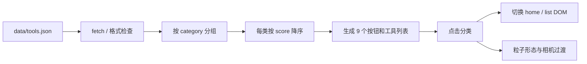

# 拾光 · AI 工具宇宙项目交接

更新日期：2026-10-18（第十六轮：发动机场景质感重做 —— 冰封地球 / 环状喷口 / 锥形等离子流）

## 本轮改动（"塑料玩具" → "硬核科幻天体"）

用户反馈：骨架对了，但质感像廉价塑料玩具。四项要求：地球压暗+冰封废土、喷口改成
向内凹陷的环状机械、尾迹从"发光管"改成被喷出来的等离子气流、构图压到右下并留白。
**这一轮没有写过场动画。**

### 1. 地球：主光源换成发动机，太阳退到 5%

- 光照：`engLit = pow(halfLambert(N·capW), 1.55)` 承担主光；太阳只剩
  `smoothstep(-0.10,0.62,N·uSun) * 0.055` 的冷光。指数一开始给 2.6，
  受光半球收得太紧，整个地球只剩喷口附近一个亮斑（实测受光侧只有 20-56）。
- 地表：深海底 0.0075/0.013/0.023、冻海 0.030/0.043/0.058、岩石 0.056/0.059/0.062、
  冰盖 0.150/0.172/0.196。冰线加了 fbm 扰动（`abs(outw.y) + (fbm-0.5)*0.34`），
  否则会出现"数学纬度环"。
- 极弱的行星反照率底噪 0.006/0.010/0.019：纯黑背景上没有它，球体边缘会糊进太空。
- 大气：菲涅尔指数 2.4 → **5.0**，强度 1.75 → 0.95。2.4 时"大气"会糊住盘面外侧三成，
  读起来是一层廉价蓝雾。
- 能量抽取痕迹：`ridged()` 噪声的 24/30 次幂 → 细丝状裂纹，只在 cap 周围 32° 内；
  再叠一层 `pow(g,14)` 的暗红余烬，让裂纹从一片余温里长出来，而不是悬空的线。
- 实测（只留地球）：p10 **6.8** / p50 **35.9** / p90 **117.5** / p99 181 / max 248，
  冰盖占 **27.4%**，红色裂纹 **2.0%**。

### 2. 喷口：17 点剖面 → 5 级环形台阶的凹陷井

上一版是 8 边形小圆台，屏幕上只有几十像素，读起来就是"灰白创可贴"。

- `LatheGeometry` 把一条剖面绕轴转一圈：外沿平台 → 唇口 → **5 道环形台阶** → 深井 → 喉口。
  14 个喷口共用这一份几何（`InstancedMesh`），仍然只有 1 次绘制。
- 主喷口 scale **1.85**（外径 0.37 世界 ≈ 124px），内圈 0.92、外圈 0.58。
- 三个必须记住的实现细节：
  1. **凹井在球面之内，地球不透明且写深度**，深度测试会把整个井挡掉（只露出最外一圈）。
     解法：喷口材质 `depthTest:false, depthWrite:false`，`renderOrder=1`（地球之后、尾迹之前），
     再在地球着色器里把 cap 周围压黑成"坑口"。因为喷口永远朝镜头，这个"作弊"没有破绽。
  2. **`LatheGeometry` 的 `uv.y` 是按剖面点序号均匀分的**，而我们的剖面点间距不等，
     用它做周期条纹会错位、并被 17 个顶点线性插值抹平 → 整块均匀发灰（实测 116~144，一个环都没有）。
     改用**半径**做分带（`cos(rr*285)`），环顶才和几何转折对齐。
  3. 环距不能小于 ~0.02 世界单位：0.013（8px）在 120px 的喷口上会和像素栅格打架，
     出现对角摩尔纹而不是同心环。
- 机身基色压到 0.017/0.022/0.029，环顶高光 0.34/0.50/0.68 × 0.52，喉口才给青白（0.55 封顶）。

### 3. 尾迹：2 列平带 → 6 列卷边锥体

- 横截面从 2 列加到 **6 列**：2 列只能画出一条平带，永远像塑料管；6 列才能做出
  "中间厚、边缘薄、边缘卷向镜头"的体积感。顶点数 110×6=660/条，3 条共 1980。
- 宽度改成真正的锥形：`0.010 + 0.58 * pow(age, 0.95)`，根部 3px 半宽 → 尾端 190px。
  指数用 0.46 的话 2% 处就张到 77px，像探照灯。
- 亮度剖面：三层（炽芯 `pow(edge,16)` / 等离子体 `pow(edge,3.4)` / 弥散光晕 `pow(edge,1.15)`）
  乘 `root=exp(-age*11)`、`fade=exp(-age*2.35)`、`head`、`tail`。
  实测沿轴峰值 **207 → 193 → 169 → 128 → 94 → 60 → 39 → 3**（宽度 17 → 216 → 400px）。
- 湍流：三倍频 value noise，`turb*1.95-0.42` 能把局部压到 0 → 气流里出现**暗缝**。
  只做 0.7~1.3 的轻微起伏的话，远处永远是一条实心带。
- 蛇行：三种频率（9.5 / 17.0 / 4.2），幅度 `age^1.4`，分别走横向基与相机法向 ——
  在三维里扭，而不是平面里摆。

### 4. 构图与环境光

- 相机：`enEl` 0.20 → **0.12**（压低），`enDist` 4.30 → **4.95**。
  构图偏移用 **`camera.translateX/Y`**（平移不改朝向），不是改 lookAt 目标 ——
  改目标会把地球与尾迹的透视关系拧掉。
  实测：地球中心 **(804,827)**、半径 **296**（视口 1008×960，右下角且被裁掉约三成 = 尺度感）；
  尾迹 (689,625) → **(59,124)**，正对左上角。
- 环境散射：两片加法 billboard —— 喷口处的球状蓝雾 + 沿喷流轴拉长的软光带（共 2 次绘制）。
- 尾迹长度是**跟着距离反解**的：拉远后每单位长度只走 (-154,-236)px，
  1.52 会让尾端悬在画面中间，2.35 才落到左上角。改 `enDist` 必须重算 `enLen`。

## 上一轮改动（行星发动机：低模地球 + 发射阵列 + socket-following 等离子尾迹）

用户要求：后 4 个分类（视频与音频 / 效率与办公 / 模型与基础设施 / 开发者作品）
右侧视口从黑洞换成行星发动机，并**先只交付第一、二阶段**（静态场景 + 交互），
过场动画（第三阶段）等确认视觉后再写。

### 0. 借鉴来源（读了源码，一行库都没引入）

| 来源 | 借的东西 | 落地方式 |
|---|---|---|
| `z0zero/3d-rockets-muse-spark-1.3` `src/three/sequence.js` | `getPhase()` / `ignitionAmount()` 的分段虚拟时间轴 | 预留 `enPower`（0→1）作为同一套状态机的驱动量，第三阶段直接接 |
| 同上 `cameraRig.js` | `k = 1-exp(-dt*2.5)` 的帧率无关缓动 + `sin(t*30)/sin(t*37)` 微震 | 相机全部用 `1-exp(-dt*7)` 阻尼；`enShake` 已接好 but 默认 0 |
| 同上 `effects.js` | 固定对象池 + 游标回绕、喷口 Glow 随点火量线性缩放 | 喷射粒子改成着色器解析式（连池都不需要，CPU 零更新） |
| `three-plume` 0.1.1 | socket-following ribbon：`capacity/sampleRate/minDistance` 固定历史缓冲、width/alpha/colorOverLife、renderRibbon 的 layers | CPU 环形缓冲（`copyWithin` 移位，零分配）+ 每帧按年龄重建顶点；色带在片元里按 `|side|` 做内芯到外辉 |

它跑在 WebGPU + TSL compute 上，本项目是 WebGL2 + GLSL，所以只翻译语义，不搬代码。

### 1. 分类分流

`ENGINE_CATS` 里那 4 个分类走发动机，其余仍走黑洞。两套视口**共用 `#bh-view` 容器**，
只切 canvas 的 `display`，布局一行没动。`bhFrame` 加了 `engineMode` 守卫，
发动机模式下黑洞循环直接 return（不空转）。

### 2. 地球：低模 + 导数面法线

- `IcosahedronGeometry(1, 4)` = 5120 面，刻意低模。
- **刻面靠屏幕导数**：`Nf = normalize(cross(dFdx(vP), dFdy(vP)))`，再与顶点法线 mix 0.62。
  不同版本 three 的 PolyhedronGeometry 法线行为不一致，导数法线是像素级真实面法线，
  与几何细节无关，低模的棱一眼可见。
- 晨昏线 `smoothstep(-0.16,0.26,lam)` —— 硬，才有"一半冻死一半烧穿"的冷硬感。
- 太阳方向 `(0.74,0.40,0.54)`：**不能正对镜头**，否则整个盘面等亮，就是一块死板圆盘。
- 大气单独一个 1.052 球，`pow(1-N·V, 5.0)` 只留贴边一圈；指数小到 2.4 会糊住盘面外侧三成。

### 3. 发动机阵列：14 个喷口 + 光点

极冠方向 `(-0.62,0.56,0.55)`（朝镜头偏上偏左），中心 1 台 + 内圈 6 + 外圈 7。
喷口本体是 `InstancedMesh`（1 次绘制），亮点是独立 `Points`（1 次绘制）。

### 4. 等离子尾迹：socket-following ribbon

```
每帧：把喷口的世界位置/世界轴向按 30Hz 推入 96 个样本的历史缓冲（copyWithin 移位）
      → 每个样本按"年龄"往外推 L*age（老的样本用老的轴向，所以地球一转，尾迹就弯）
      → 横向量 cross(轴向, 相机方向) 让 ribbon 永远正对镜头
      → 宽度 0.032 → 0.37 世界单位（10 → 110px），三次低频摆动做蛇行
      → 只重写 position / aCross 两个 Float32Array
```
3 条尾迹共 654 面、660 顶点，绘制 3 次。**全程没有一帧 new 对象**。

### 5. 三个"静默失败"的坑（都以"看起来没效果"的形式出现）

1. **加法混合里基色超过 1 = 自动变白。** 上一版 `hot=(0.92,0.97,1.00)` 再加 0.9 的炽白芯，
   单条就已经三通道削顶；三条一叠 → 画面顶部一条 275px 长的纯白板（实测 RGB 全 255）。
   基色必须压到 `(0.42,0.72,1.00)`，炽白只留 `pow(edge,18)*0.55` 那一根细芯。
2. **`vec4(c*a, a)` + 加法混合 = a²。** 横截面实测：中心 127，四分之一宽只剩 20，
   "蓝白渐变"整条塌成一根细线。改成 `vec4(c,a)`，让 a 只作用一次，宽度立刻回来
   （0/±0.25/±0.5/±0.75 → 101/62/40/39）。
3. **极冠基色 0.52/0.61/0.68 乘 2.15 就三通道越界。** 画面顶上那条 300px 白带不是尾迹、
   不是大气，是冰盖被裁成纯白。定位手法：把 `enGroup.children` 逐个 `visible=false`，
   看哪一个让"三通道同时 >245"的计数归零。

### 6. 交互（第二阶段）

- 拖拽 = 真轨道：`enAzT -= dx*0.0052`、`enElT += dy*0.0040`，**俯仰夹在 [-0.06, 1.16]**。
- 滚轮 = 距离指数缩放，`[1.62, 6.20]`。最近 1.62 时相机仍在球面（半径 1）之外，
  实测 `el=-0.06 / dist=2.6` 时相机 y=-0.156、水平距离 2.595 → 不会穿模。
- 地球自转 0.030 rad/s，相机跟随 92%，剩 8% 残差让发动机簇在两分钟里极缓地擦向球缘
  ——既不会转到背面消失，也不会像贴纸一样钉死。
- 滚轮分支必须写在 `if(current!==null)return` **之前**，否则分类页根本走不到（踩过）。

## 上一轮改动（核球砍到 900 颗 + 10 pass 自研 Bloom，历史记录）

用户要求两件事，而且这两件事在加法混合下是**互相矛盾**的：
"削减中心粒子密度"会让中心更暗（亮度 = Σ(color×alpha)，粒子少了自然暗），
但用户同时要"更亮、极其耀眼"。所以这一轮的核心不是调粒子，而是**把亮度从"粒子数量"
转移到"少数极亮粒子 + 后处理泛光"上**。

### 1. 核球：3400 → 900 颗，四层结构

| 层 | 数量 | 半径（世界 / 像素） | 尺寸 | alpha | 作用 |
|---|---|---|---|---|---|
| 炽核 | **80** | < 0.16 / 10px | 4.7-8.6px | 0.90-1.00 | 泛光的燃料 |
| 内核 | 300 | 0.045-0.22 / 3-14px | 1.0-2.0px | 0.55-0.90 | 细碎颗粒感 |
| 中环 | 280 | 0.20-0.55 / 13-34px | 1.5-3.4px | 0.34-0.56 | 填 14-34px 的亮度肩部 |
| 金晕 | 240 | 0.50-0.95 / 31-60px | 2.0-4.7px | 0.46→0.25 | 淡金黄外圈 |

**为什么加"中环"这一层**：只靠加大泛光去补 10px→30px 的肩部，会把整片旋臂一起泛白
（实测盘面从 6.5 抬到 14.5，锐利度明显下降）。加一层中等亮度的粒子更省、更准。

**四层都用斐波那契球采样**，不用随机球面。随机撒点必有团块，投影出来是个歪的亮球：
实测光球边缘半径在 12-21px 之间跳（最大/最小 1.75）。黄金角螺旋能把每层铺得角向均匀，
二阶矩长/短轴比从 1.75 降到 **1.10**（1.00 = 正圆）。

### 2. 自研 Bloom：vendor 里没有 EffectComposer

vendor 只有 `three/build` 和两个 addon（OrbitControls / RoundedBoxGeometry），
没有 `examples/jsm/postprocessing`。所以手写一条最简流水线：

```
场景 → rtScene（全分辨率，锐利度零损失）
     → 亮部提取 + 降采样 → 1/2 → H/V 高斯 → 1/4 → H/V → 1/8 → H/V → 1/16 → H/V
     → 合成：base + Σ(wᵢ · blurᵢ)，最后过 g/(1+g) 软肩
```

**10 个 pass**（1 亮部 + 4 级 × 2 次可分离高斯 + 1 合成），帧间隔仍是 16.7ms。

四个关键设计，每个都是踩过坑才定下来的：

- **必须四级，不能三级**。只有 1/2、1/4、1/8 时最大有效模糊半径约 13px，
  光晕在 60px 就断了；加一级 1/16（1440 宽时只有 90px）才能把半径拉到 ~50px。
- **第一级不能写进自己采样的纹理**。亮部结果要写进 `bloomRT[0].b` 再从 `.b` 采样；
  如果写 `.a` 再采 `.a`，就是同一纹理读写（自反馈），GL 直接返回黑 ——
  表现为"泛光完全没效果"，实测加不加一模一样（盘面 6.5 vs 6.5）。
- **软肩 `g/(1+g)` 不能省**。8 位 RT 存不了 >1 的值，直接 `base + g*strength`
  会把一大片钳成纯白、与外围形成硬边 —— 那是"白盘子"，不是光球。
- **泛光要偏暖**。亮部提取出来的是白核的近白色（1, 0.97, 0.92），直接相加会把
  外圈的金色冲成中性白（实测暖色像素从 18.9% 掉到 7.2%）。
  合成时乘一个 `(1.00, 0.945, 0.855)` 的暖偏，暖色回到 13.9%，而且物理上也更对：
  高色温光源的辉光本来就偏暖。

### 3. 参数是量出来的，不是猜的

`.checks/bloom-decide.cjs` 会对每个候选同时量"核心亮度"与"旋臂是否被泛白"
（后者用盘面平均亮度 + 亮度变异系数 CV）。关键数据：

| 阈值 | 强度 | 20px 亮度 | 60px 增益 | 盘面抬亮 | CV（底 2.85） |
|---|---|---|---|---|---|
| 0.28 | 3.1 | 141 | 2.2x | **2.23x** | 2.76 |
| 0.42 | 3.0 | 96 | 1.8x | 1.52x | 2.36 |
| 0.42 | 5.0 | 120 → **116** | 1.7x | 1.86x | 2.24 |
| 0.50 | 3.4 | 88 | 1.2x | 1.22x | 2.76 |

最终取 **阈值 0.42 / 强度 5.0 / 权重 1.05·0.92·0.78·0.60**：
旋臂 p90 只有 21/255≈0.08，远在阈值之下，泛光只由核球驱动；
20px 处亮度是关泛光时的 3.4 倍，光球半径 128px。

### 4. 只在首页启用

进入分类页时 `bloomK` 缓动到 0，**整条 bloom 链路直接跳过**（回落到原来的直出路径），
所以黑洞页那套已验证的性能与画面完全不受影响：仍是 1 次绘制、倍率 0.82。

## 上一轮改动（首页去贴图化：8.2 万颗粒子，0 张纹理，2 次绘制，历史记录）

用户反馈很明确：中心像"被打码"，粒子太大像色块，**要求放弃一切贴图和渐变伪装星云**。
上一轮我加的旋臂气层（1024² canvas）+ 核球泛光（billboard + 解析剖面）虽然解决了
"点阵感"，但它本质是贴图——放大到 1440px 就会露出低分辨率的软糊边。
这一轮把它们**全部删除**，只用粒子重做。

### 1. 删掉的东西（净减 30KB 代码）

| 删除 | 原因 |
|---|---|
| `NEB_FRAG` + `makeNebulaTexture()`（2048×1280 / 1024² 两张烘焙 RT） | 背景星云是"打码感"最直接的来源 |
| `deepSpaceTexture()` + `deepBase`（CanvasTexture 深空底） | 背景改为 `clearColor` 纯黑，不需要贴图 |
| `makeArmHazeTexture()` + `hazeA/hazeB`（1024² 旋臂气层） | 低分辨率贴图的软边就是"假" |
| `CORE_GLOW_FRAG` + `coreGlow`（billboard 泛光） | 同上，改为粒子堆叠 |
| CSS `body` 的三层径向渐变 | 上一轮已清，这轮确认背景 `#000` |

`renderer` 也从 `alpha:true` + `setClearColor(0,0)` 改成 **`alpha:false` + `0x000000,1`**：
不透明黑最干净，也省掉一次浏览器合成。

### 2. 粒子系统重建：83400 颗，两层绘制

| 层 | 数量 | 尺寸 | 混合 | 作用 |
|---|---|---|---|---|
| 宇宙星场 | 7050 | 0.34–3.07 | Additive | 背景星空 |
| 核球（白核 + 金晕） | 3400 | 1.5–6.0px | Additive | 极度明亮的球状核心 |
| 旋臂星尘 | 72000 | **平均 1.35px / 最大 2.38px** | Additive | 细碎锐利的盘面 |
| 星际尘埃带 | 3600 | 3.5–11px | **纯吸收** | 遮挡背后的光，造沟壑 |

**尺寸缩小 70%**：旋臂 aSize 从 `.034~.184`（投影 2~12px）改为 `.012~.036`（1.35px 平均），
同时把数量从 5000 提到 72000。这是"细碎"与"不空"之间唯一的解法——
单颗缩到 1px 级之后，只能靠数量把密度补回来。

**材质换成纯高斯衰减**：旧版是 `exp(-d2*42)`（中心≈1 的硬核）+ 一层弱光晕，
缩到 1-2px 之后那等于一个方形色块。现在整块都是软的：
`a = exp(-d2*11) * (1 - smoothstep(0.12, 0.25, d2))`，边缘平滑收到 0，没有圆盘硬边。

**点尺寸下限提到 1 个物理像素**：`clamp(..., uPixelRatio*1.0, ...)`。
上一版是 0.5px——缩到亚像素后整层会闪烁/消失（这个坑在星场那次已经踩过）。

### 3. 核球：白色内核 + 金色外晕

核心不是"一个亮点"，而是两个半径分布不同的粒子群：

- **内核 30%（1020 颗）**：r < 0.20 世界（约 12.5px），尺寸 1.5-3px，alpha .60-1.00，
  颜色只取色带最内侧（近白）。密集重叠 → 中心过曝成白。
- **外晕 70%（2380 颗）**：r 0.20 → 2.0 世界（12.5-125px），尺寸 5-11px、alpha .30-.50
  并随半径线性降到 40%，颜色落在"金"档（HSL h≈0.09 / s≈0.88 / l≈0.76）。

**"淡金黄"为什么必须由外晕来给**：additive 下亮度 = Σ(color × alpha)。
小粒子要靠高 alpha 才亮，而高 alpha 一叠，R/G/B 会**同时**顶到 255 —— 金色立刻被削平成白。
大粒子 + 低 alpha 能在同样亮度下保住 R:G:B 的比例。
上一版外晕 alpha 只有 .10，实测 22px 处是 36/36/35（纯中性灰），就是这个原因。

**尺度换算（这次才算对）**：1 世界单位 ≈ **62.7px**（不是 121）。
按错的尺度铺外晕，它会在 64px 处突然断掉——实测剖面 45px=43.5 → 65px=6.8，
核球像被切了一刀。修正后外晕铺到 2.0 世界（125px），剖面连续。

### 4. 差速旋转：从"整体刚体转"改成"逐粒子开普勒"

原来自转是 CPU 每帧算一个旋转矩阵（`matC.makeRotationZ(gSpin)`），整个盘刚体转。
现在：

```glsl
float omegaFor(float rho){ return pow(max(rho,0.10), -0.70); }
// 顶点着色器里按盘面局部坐标旋转，再交给 uGalaxyMat 做倾斜/进动
float ang = uSpin * omegaFor(length(position.xy));
```

`uSpin` 是 CPU 只送一次的累积相位。内圈 om(0.3)=2.32、外圈 om(5.4)=0.31，
**快 7.56 倍**——实测 1.5 秒内核心区 39.9% 像素变化、外环 12.1%。

同时 `updateGalaxyMatrix()` **不再叠整体自转**：差速已经逐粒子做了，
再乘一个刚体转速等于给内圈加两倍速，差速会被抹平。

悬停高光也跟着改：扇区角在着色器里加上 `ang/2π` 再比较，
否则高光会和旋臂脱开（一个在转一个不转）。

### 5. 星际尘埃带：必须用"纯吸收"混合

这是本轮最容易做错的一步。上一版用 `NormalBlending` + 深褐，
结果**盘面平均亮度反而从 1.86 升到 1.91**——暗色叠在纯黑背景上等于往黑里加褐，
既没挡住光，还糊了一层褐雾。

正确做法是乘法式吸收：

```js
blending: THREE.CustomBlending,
blendSrc: THREE.ZeroFactor,
blendDst: THREE.OneMinusSrcAlphaFactor,   // 结果 = dst × (1 - alpha)
```

只压暗、绝不加亮。于是尘埃在纯黑处不可见，只在有光的旋臂上显形——这才是物理正确的。
实测：盘面平均 10.75 → 7.60（压暗 **29.3%**），有光像素中 **52.1%** 被压暗两成以上。

尘埃位置在旋臂**之间**：`arm*72° + r*1.24 + 36° - r*0.22`，抖动收窄到 ±0.15 rad
（±0.30 会摊成均匀褐雾），半径从 1.30 世界起（核球内不铺，真实星系核心也被辐射清空）。

### 6. 文字保护

按用户点名的写法：`text-shadow: 0 2px 10px rgba(0,0,0,.9)`，
再叠一层 `0 1px 3px rgba(0,0,0,.95)` 护住笔画边缘；
`.hero::before` 一层径向暗场（中心 0.58 → 0 收边）压住背后的粒子亮区。
实测标题对比度 **49.52:1**，字间第 10 百分位亮度 0（纯黑）。

## 上一轮改动（首页星系：从"发光线圈"到"有体积的天体"，历史记录）

用户反馈：首页主星系读作"廉价的发光线圈"，缺厚重感；核心空、螺旋是光秃秃的点阵、
四角有灰绿光晕。这一轮只动首页的 3D 渲染与 Hero 排版，**左侧面板与黑洞页一行未改**。

先量化再动手：把改动前的版本放到站点根目录做同源 A/B（`.checks/p14-verify.cjs` 会自动
建/删 `_ab-old.html`），逐项对比同一指标。

### 1. 核球：亮度、密度、色温三件事一起改

| 指标 | 改前 | 改后 |
|---|---|---|
| 峰值亮度 | 255（但只有 ~6px 半径） | **255**，且饱和区扩到 ~20px |
| r = 40px 平均亮度 | 24.4 | **154.3** |
| r = 80px 平均亮度 | 29.7 | **70.3** |
| 核球暖色像素占比 | 0.1% | **41.3%** |
| 径向色温 | r30 65/65/71（中性灰） | r30 **182/164/152**（暖）→ r170 16/16/32 → r260 7/6/13 |

三处根因，缺一不可：

- **密度**：核球粒子原来只占 8.3%（`i%12===0`，417 颗）铺在 r<1.3 的球里，中间必然露黑底。
  改成 20%（`i%5===0`，1000 颗）并拆成"致密核（42%，r<0.42）+ 宽松外晕（58%，r<1.55）"。
- **色带**：原来在 **RGB** 里从金黄 lerp 到蓝，中点正好是 R≈G≈B 的中性灰 —— 这就是
  "发光线圈"观感的第一个来源。改成 **HSL** 插值（色相连续转、明度不掉进灰区），
  路径是 纯白 → 淡金黄 → 奶白 → 冷白 → 浅蓝 → 蓝 → 深靛紫。
- **泛光**：vendor 里没有 EffectComposer，做不了真 bloom。但 bloom 的本质是
  "同一束光的多个模糊尺度叠加"，于是用一个**全屏 billboard + 四段解析剖面**
  （`g1..g4`，σ 从 0.072 到指数尾巴）在 1 次 draw call 里做出来。
  这比后处理更可控：想调"光晕铺多远"直接改 σ，不用调阈值/强度两套参数。

### 2. 旋臂气层：把点阵连成介质

粒子再密也只是点阵。真实星系照片的"实心感"一半来自气体与尘埃的连续辉光，
所以在粒子**下面**铺两层盘面贴图：

- `makeArmHazeTexture()`：1024² 画布上一次生成。用**和粒子同一套螺线公式**
  （`arm*2π/5 + r*1.24`）沿五条臂画 430 个椭圆软团，再撒 520 个絮状团块 +
  70 个整盘底光，最后用 `destination-in` 收边、`destination-out` 挖掉中心
  （核球由泛光层负责，不能叠出第二个蓝核）。
- 主气层压在 z=0，副气层沿**盘法向**偏移 0.16（`galaxyMat` 的第 3 列就是法向），
  倾斜时两层错开一点 —— 这点错位就是"气体有厚度"的直接证据。
- 两层都用 `quaternion.setFromRotationMatrix(matA)`，与粒子共用同一套
  倾斜 + 进动 + 自转矩阵，所以是"长在盘里"，不是贴在屏幕上的光斑。

效果：盘面（±300×±110 椭圆内、核球以外）有光像素占比 **60.2% → 87.9%**，
同时旋臂起伏仍在（沿环采样 CV **0.68 / 0.66 / 0.65**，最暗 2~16、最亮 199），
没有被糊成一张均匀的圆盘。

### 3. 底色：灰绿光晕的真凶是 CSS

先查了数据：改前四角是 tl 7.1/8.3/13.2、tr 6.0/5.7/8.7、bl 4.7/4.6/7.7、br 21.9/14.4/17.5。
但 `body` 上的三层 CSS 径向渐变正好落在 `76% 12%`（右上）与 `15% 84%`（左下）——
和用户点名的两个角完全吻合。所以：

- `body` 背景直接改 `#000`；`deepSpaceTexture` 也清成纯黑，只留中心一团躲在核球背后的深紫。
- 星云整体亮度再压一半（`base*(0.22+emit*0.58)`），不透明度 0.15-0.20 → **0.085-0.125**，
  径向衰减 `0.50→1.42` 收到 **0.38→1.14**（原来右下角距核心仅 0.7，还拿到 90% 强度）。
- 配色去掉暖粉：`cGlow` 从 (0.76,0.47,0.47) 改成 (0.56,0.48,0.72)，
  全路径保证 **B 最高**（G 反超 R 就是"灰绿"）。

结果：四角 **0.23 / 0.22 / 0.16 / 3.80**（最大通道 4.24），tr 与 bl 从 8.7 / 7.7 直接归零。

### 4. 倾角与厚度

- 相机俯角 **21° → 30°**。盘面投影高宽比 0.407 → **0.332**（扁了 18%），
  椭圆透视一眼能看出来。（注意：这个比例还要除以视口 1.5:1，像素比才是真实观感。）
- 盘面厚度：`thick = .42*exp(-r*.62) + .085 + r*.028`（原来外盘只剩 0.06 ≈ 4px，侧看是一条纸），
  垂直分布改成两个随机数相加（近似三角分布）—— 粒子集中在薄盘附近，少数甩到外面形成稀薄外晕。
- 盘面内缘从 0.12 提到 0.34，核球与外盘之间才有清晰的核球边界，不会糊成一团。

### 5. 标题暗场

`.hero::before` 一层径向黑渐变（中心 0.34，向外收到 0），配合收紧的 `text-shadow`
（从 54px 的近黑外发光收到 24px —— 原来那圈大阴影本身就是一块"暗斑"）。

量法：取标题正下方一条**无字形覆盖**的控制带，比较开/关暗场后的中位亮度 ——
保留 **72%**，即压暗不到三成：字间足够读、星系仍然透得上来。
标题对比度 **33.99:1**，字间第 10 百分位亮度 2.3。

### 6. 代价：绘制调用 4 → 7

+2 层气层、+1 核球泛光。帧间隔中位仍是 **16.7ms**（p90 17.0），没有变慢。
气层与泛光在进入分类页时缓动淡出（`hazeK`，~0.9s），所以黑洞页的绘制仍是 1 次、
左侧面板标题对比度 11.39:1 不变。

## 上一轮改动（修左侧白灰块、加深多普勒、环闭合、引力透镜加强，历史记录）

用户反馈：右侧物理形态已经对了，但左侧盘与下方光子环的交接处有一大块"灰白色、马赛克锯齿状"
色块，周围还有细碎白点；左侧该暗却没暗；左段环与下方环的接角生硬；鼠标引力看不出来。

这一轮没有靠猜，而是先做了三件事把问题**定位到像素级**：把画面降采样成 ASCII 亮度/饱和图、
沿关键行打印真实 RGB、再用 `uDbg.y` 输出"每次盘面穿越的 D 与 rho"作为伪彩色。结论与直觉不同——
白块不是环项造成的，把环项整体关掉（`uDbg.x=0`）它依然在。

### 1. "灰白马赛克"是三个独立成因叠出来的

**成因 A：掠射弦长用了硬 `max`。**
`chord = min(2H / max(|vy|, 0.010), 9.0)` 有两个硬折点。`|vy|` 跨过 0.010 的那一列像素，
弦长在一个像素内跳两个数量级，`tau` 直接顶到饱和值 2.1，色块边界就是锯齿。改成软分母

```
soft = sqrt(vy² + 0.00090)   // ≈0.030 的软下限
chord = 2H / soft
```

曲线处处连续，锯齿消失（盘缘跳变实测 1.8%）。

**成因 B：冷白基色 × 红移 = 中性灰。**
旧配色是 `cHot(0.86,0.92,1.00)` 再乘红移 `(1.40,0.66,0.36)`，R 与 B 互相抵消，正好落回中性灰。
现在换成**观测色温 → Planck 色带**的单调映射 `tempColor(T)`：温度一降，颜色沿
冷白 → 暖白 → 橙 → 暗红 → 近黑 滑下去，数学上不经过灰色。

**成因 C：第二次盘面穿越被全额累加，叠上 13 倍集束后全通道削顶。**
这是白块的**主体**。调试输出显示那块区域的 `dbgN=2`、末端 `D≈1.8`、`rho≤R_IN`：
光线绕过黑洞后又穿了一次盘面，交点半径被钉在内缘，`D=1.8` 时集束给 `1.8^4.4×0.62 ≈ 13.5` 倍，
ACES 之后 R/G/B 同时到 1.0，色相被完全削平——所以看起来是"灰白"而不是"亮"。

处置分两层：

- 静止温度从 9000K 降到 **7000K**，`rho` 下限钉在 `R_IN*0.98`，集束权重收到
  `min(D^4.0 × 0.72, 3.20)` —— 任何区域都不再被推到全通道削顶。
- 高阶像只留 **10%**（`passW = passN<2 ? 1.0 : 0.10`）。n≥1 的像本来就由解析环项负责，
  积分器再全额算一遍是重复计数，而它的采样步长在这个尺度上根本不够细
  （交点的 `rho` 会在相邻像素间跳 0.3~1.5），正是"马赛克"的来源。

另外，盘的内缘径向窗起点**必须贴着 `R_IN`**（`0.94~1.06`）。往里放宽到 `0.80` 会让
`rho < R_IN` 的"空穿越"进来，而 `(R_IN/rho)^1.15` 在那里会飙到上万 K，直接烧出一条冷白亮带。

### 2. 多普勒：从"渐变"改成"断崖"

三个参数一起动，缺一个都出不来极端对比：

- 色移指数 1.0 → **3.2**：`Ts = T(r) · D^3.2`。物理值只够把左侧压成暖黄，
  要"深暗红到近黑"必须加大。
- 集束指数 3.6 → **4.0**，下限从 `clamp(D,0.26,…)` 放到 **0.020**，上限夹 3.20。
- 温度剖面指数 1.15：内缘 7000K，外缘 ≈2900K，即使不做多普勒也是"内白外红"。

实测：盘带左峰 92 / 右峰 234，平均 16.9 vs 193.6 = **11.5 倍**；左端 RGB 落到 `47/19/4` 这种
暗砖红，再往外直接进黑。

### 3. 环闭合：给背向侧留一层"暗红余烬"

多普勒一压，左半圈直接消失——实测有 6 个方向掉到 9~11（等同全黑），又变回"断环"。

根因是环的亮度被三层窗口连乘：`ringWin`（内外缘 × 平面窗）× `stack` × `trans`。
任一层接近 0 就整体归零。处置：

- 环的多普勒改用**屏幕方位角** `sx = uv.x/|uv| · 0.82`，与逐点 `dot(vh,nobs)` 同一约定，
  但它是 `uv` 的连续函数，不会再从积分步上取点（上一版用 `pNear`，步长相位的跳变
  就是环上马赛克色块的另一半来源）。
- `stack` 底从 0.34 抬到 **0.50**，`trans` 下限从 0.34 抬到 **0.55**（近侧盘挡在环前时，
  环不该被压没，否则接角处出现一个生硬的"断角"）。
- 加一层**暗红余烬下限** `dcP = max(dcP, vec3(0.360, 0.072, 0.024))`：几何上永远闭合，
  亮度只有迎面的 1/8。

实测：72 方向 **0 个暗断点**，最暗 20 / 中位 157 / 最亮 231，左均 41.3 vs 右均 217.9 = **5.3 倍**。

### 4. 鼠标引力：确认生效，并改掉会"翻转采样"的公式

先确认它一直是生效的（`uMouseK` 悬停 0.979、移出 0.10；局部像素变化 5.1% vs 基线噪声 0.79%）。
问题是两点：

- 纯 `β = θ - θE²/θ` 在 `θ < θE` 时会把采样点**翻到光标对面**（θE=0.138 时相当于光标周围
  66px 被倒置），星星被打成一团乱码而不是"被拉扯"。
- 作用半径只有 0.40，稍远就看不出来。

现在把位移夹在 `0.34·θ` 以内（`pull = min(θE²/θ, 0.34·θ) · exp(-(θ/0.58)²)`），永不越界；
作用半径 0.58（约 0.29 屏高），叠加 0.34 的切向卷曲让星星被拉成弧。
光标周围 0.3 屏高内星点位移实测 **20~23px**。

> 测这件事有两个坑，写在「已知限制」里：悬停本身会带动相机（`bhHoverX*0.05`），
> 直接开关鼠标会把"相机移动"算进"透镜效果"；另外开了第二个页面做像素分析后，
> 主页面会变成后台页、rAF 被节流到 1fps，性能数字会变成 1000ms 级。

## 上一轮改动（修"水母"、给透镜厚度、加鼠标引力，历史记录）

上一版盘已经压扁了，但仍然读作"发光水母"：盘在前侧断开、上方透镜弧是一根锐线、
背景四周有一层灰绿雾。这一轮把这四件事逐个查清并修掉，另外加了一个屏幕空间的鼠标引力。

### 1. "断裂"的真正原因：紧贴视界的环整圈是空的

先把问题量化：沿中心竖列取亮度剖面，发现**阴影边缘那一圈完全为 0**——
而它正是近临界光线（`b ≈ b_crit`）绕行形成的 n≥1 级像。

原因是积分预算：`b` 略大于 `b_crit` 的光线要绕黑洞接近一整圈才会再穿一次盘面，
按 0.0108 rad 一步需要 580+ 步，而当时 `MAX_STEPS` 只够绕 0.7 圈。
所以那些像根本没被算出来，画面上就是"盘在前侧断开、环和盘接不上"。

**解法不是继续堆步数**（会直接拖垮帧率），而是把 n≥1 的像**解析求和**：
它们沿 `b` 方向按 `e^(-nπ)` 几何收敛，闭式求和即可。做法是
在积分过程中顺手记录"全光线离盘面最近的点"，循环结束后用它作为交点的代表，
按 `exp(-(b-b_crit)/w)` 的权重把内缘辐射叠上去。

这一步踩了两个坑，都记在下面「已知限制」里：
- 判据必须只对**逃逸**光线生效。被吞掉的光线也会贴着盘面螺旋下坠，
  照样能满足"接近临界"的条件，结果把整个阴影填满，黑洞直接消失。
- 代表点的半径要用**三维半径**。用 `xz` 投影时，轨道偏上会让它趋近 0、
  落到盘内缘之外，`dens` 变成 0，整条环凭空消失（实测 `densP` 全为 0）。

### 2. 环的厚度与"甜甜圈"问题

n≥1 的像是绕行多圈叠加出来的，湍流的暗纹早被抹平了。直接沿用单点的密度会让环
"随气流明灭"——实测 180° 附近从 249 掉到 10，就是一个假断口。所以给环的密度加了底
（`mix(0.72, dens, 0.42)`）。

但把环填满之后又变成了一圈均匀的发光甜甜圈。真实的透镜弧是**横带亮、上下细**，
于是再加一层物理上说得通的调制：光线轨道离盘面越远，能捡到的盘光越少

```
planeClose = mix(0.34, 1.0, exp(-(|y|min/(4.6·H))²))
```

水平方向（轨道几乎贴着盘面）最亮，上下两段被压薄。给它留 0.34 的底是为了保证不断。

### 3. 多普勒反差：拉开，但别削平色相

亮度指数从 2.2 提到 **3.6**，同时把系数从 2.05 **降到 1.05**。
这一步很关键：原来的亮度把两侧都顶到 255 纯白，色相被削平，
"迎面偏蓝、背面偏橙"根本显不出来。压低之后高光才保得住颜色。

频移改成**乘性偏色**（不能 `mix` 替换，否则整个外圈会被染蓝、径向温度层次全丢）：
蓝移 `(0.74,0.87,1.30)`、红移 `(1.40,0.66,0.36)`。

### 4. 背景的灰绿雾

`sky()` 里有一层"星际尘埃"：`vec3(0.020,0.030,0.055) × 噪声`。
`G(0.030) > R(0.020)`，经过 ACES 之后就是 7/255 的青灰——**这就是那股脏雾的唯一来源**，整段删掉。

### 5. 鼠标引力透镜（屏幕空间位移）

在 `main()` 取光线方向**之前**先把采样坐标掰弯，所以吸积盘、光子环、背景星空会一起被拖动——
这正是 `ShaderPass` 做的事。点透镜的偏折 `β = θ - θE²/θ`：采样点向鼠标靠拢，
图像被径向压缩、切向拉长，划过星场时星星就被拉成弧线。

- 纯 `1/θ` 衰减太慢（光标在左上角，右下角的星星也会被推走 7px，整个星空像在漂），
  所以乘了一层高斯包络把它局部化。
- 指针进出视口时强度做缓动（5.5/s），不跳变。
- **拖拽时强度降到 0.35**，松手恢复——两个交互都保留，但公转读得清。

## 上一轮改动（黑洞整形，历史记录）

上一版物理是对的，但构图和参数严重失调：盘比视界大 3 倍多，加上零厚度的数学平面，
渲染出来是一个"发光蘑菇 + 一条斜线"。这一轮只调参数与介质模型，物理内核没动。

### 1. "蘑菇"的成因：盘/视界比例

屏幕上，阴影半径 = `(b_crit/CAM_D)/TF`，盘半径 = `(R_OUT/CAM_D)/TF`，
两者之比只由 **`b_crit/R_OUT`** 决定，跟相机距离和视场无关。

上一版 `R_OUT=8.0`、`b_crit=2.598` → 盘比视界大 **3.1 倍**，再叠上被弯折到头顶的远侧盘像，
自然就是蘑菇。把 `R_OUT` 收到 **5.4**，比例变成 **0.48**，视界立刻立得住：

| | 上一版 | 本轮 |
|---|---|---|
| R_OUT | 8.0 | **5.4** |
| R_IN | 2.60 | **2.42** |
| CAM_D | 17 | **19** |
| TF（视场） | 0.32 | **0.30** |
| 阴影半径 | 229px | **219px（占画幅高 46%）** |
| 盘/视界比 | 3.1 | **0.48** |

俯仰从 0.115 rad 压到 **0.085 rad（4.9°）**，可拖拽范围收紧到 **-0.20 ~ 0.34**——
上一版能拉到 0.66，那正是"罩子太高"的来源，现在拉不上去了。

### 2. 真正让视界"看得见"的，是盘的厚度

零厚度的数学平面在掠射角下只剩一条线，视界上方完全没有光，所以黑洞读不出来。
改成**有厚度的介质**：光线穿过盘的弦长 `2H/|sin(入射角)|`，光学深度 `τ = ρ·chord`，
`α = 1-exp(-τ)`。掠射时光程极长 → 亮；正射时短 → 淡。

这一改同时解决了两件事：
- 侧面看是一条**有厚度的亮带**，而不是一条线；
- 视界周围出现**成圈的细密光环**（那里的光线近乎切向，任何半径的穿越都会累积亮度）。

`DISK_H = 0.115`（约盘内缘半径的 4.8%）。

另外，上一版视界上方全空还有一个更硬的原因：**临界光线要绕黑洞大半圈**才能形成 n=1 次级像，
按 0.0095 rad 一步需要 580+ 步，而当时 `MAX_STEPS=230`，光线根本走不完循环。
现在 `MAX_STEPS=620`，并且步长按"离临界有多近"分配
（b≈b_crit 的细到 0.0072 rad，其余粗到 0.0195），把算力只花在那圈光环上。

### 3. 闪烁：三个源，逐个处理

实测手段：连拍多帧，逐像素取"6 帧内的最大-最小亮度"，只看亮区。

| | 处理前 | 处理后 |
|---|---|---|
| 40ms 间隔（帧间） | mean 8.1、跳变>40 的像素 **3.2%** | mean **1.64**、**0%** |
| 1100ms 间隔（漂移） | mean 31.9、**26.4%** | mean **9.5**、**2.4%** |

- **自转过快**：内圈角速度 `om` 从 3.2 降到 **0.30**（`om ∝ r^-1.5`），内缘一圈约 78 秒。
- **湍流时间演化太快**：噪声的 `uTime` 系数降了约 3 倍（0.02→0.0009、0.038→0.0016）。
- **亚像素亮弧走样**：内部渲染倍率从 0.8 提到 **0.82**（默认）并把下限从 0.58 提到 0.66；
  更重要的是把密度阈值放宽（`smoothstep(0.28,0.86,n)`）并压住内圈的湍流幅度
  （`nAmp` 从 0.42 起），让最薄的那层弧不再"非黑即白"。
- 关于"Bloam 泛光"：**这个场景里没有任何后处理**（无 EffectComposer / UnrealBloom / 任何 bloom pass，
  `grep -c "bloom" index.html` = 0）。之前"糊成一团"是两件事叠加：盘的光学深度被 `tau` 上限
  3.4 直接推到饱和（α→1，硬边），以及整体乘了 2.35 的亮度。现在 `tau` 上限压到 **2.1**、
  亮度系数降到 **1.55**，峰值从 255（溢出）回到 **245**。
- 关于"粒子 Z-fighting"：吸积盘**不是 Points**，是逐像素解析求交，不存在深度冲突；
  全屏四边形本来就是 `depthTest:false`（它没有深度语义）。

### 4. 色温分级

改成按半径直接给色，而不是 `T^(-3/4)` 再映射一次：

`蓝白 (0.74,0.86,1.00)` → `暖白 (1.00,0.88,0.68)` → `橙 (0.86,0.44,0.14)` → `暗橙 (0.30,0.088,0.030)`

实测沿水平方向（迎面侧）：

| r/R_shadow | rgb | 说明 |
|---|---|---|
| 0.95 | (230,229,228) | 内缘近白 |
| 1.10 | (207,199,189) | 暖白 |
| 1.40 | (102,65,29) | 橙 |
| 1.55 | (101,54,14) | **暗橙，R 远高于 B** |
| 1.85 | (187,137,66) | n=1 弧（被透镜压缩后的外盘） |

多普勒的偏色从"直接 mix 成蓝色"改成"乘一个轻微色偏"——上一版用 `mix` 替换，
整个外圈都被染蓝，径向"内白外橙"的温度层次全丢了（这也是它看起来像"烧红的铁丝"的反面：
外圈失去暖色，只剩高饱和的橙红硬边）。

### 5. 构图

- 视界中心移到视口 **57.5% / 45.5%**（注意 `vUv.y` 自下而上，想往下移要**减小**这个值）。
- 盘左缘在画幅 11.5% 处才开始淡入（x=96 亮度 5 → x=216 亮度 43），
  与左侧面板之间留出约 116px 的纯黑呼吸区。

### 6. 性能

**稳定 60fps**：帧间隔中位 **16.7ms / p90 17.2ms**，120 帧**丢帧 0**，视口 **1 次绘制**。
内部渲染倍率自适应收敛在 **0.82**（826×787 上采样到 1008×960）。

## 上一轮改动（黑洞换成真实光线追踪，历史记录）

上一版右栏是一个 2D 近似：用一次径向重映射伪造透镜、用一条画出来的椭圆带当吸积盘。
盘面没有任何三维关系（只是一条斜线），也没有前后遮挡——所以看起来像贴图。

这一版改成**逐像素积分光子轨道**。没有引入任何外部库（`hero-black-hole-lens` /
`blackhole-ts` 在项目里不存在，且本项目坚持零外部依赖），而是自己写。

### 1. 做法：史瓦西时空里的光子轨道

每个像素发一条光线，在由「相机位置 + 光线方向」张成的平面内求解零测地线方程

```
d²u/dφ² + u = 1.5 · rs · u²        (u = 1/r)
```

用速度 Verlet 步进，步长按半径自适应（近洞 0.007 rad，远处 0.055–0.165 rad），
最多 230 步。于是下面这些都是**算出来的**，不是画上去的：

- **引力透镜**：光线被弯折，逃逸后用它**最终的**方向去采样星空，
  于是背景星点在环附近被拉成弧形、出现爱因斯坦环。
- **三维吸积盘**：每步把光线位置还原成 3D 坐标，检测与赤道面 y=0 的穿越，
  用插值求交点、算交点半径。近侧盘因此挡在洞的**前面**，远侧盘被洞挡住，
  它的光还被弯到洞的上方和下方——这就是那两道标志性的弧。
- **多普勒集束**：交点处按开普勒速度 `v = sqrt(GM/r)` 算速度矢量，
  `D = 1/(γ(1-β·n̂))`，亮度乘 `D^2.5`，色温按 D 偏移（迎面偏蓝白、背面偏暗红）。

### 2. 一个必须用解析解的判据

阴影边界不能用"积分到掉进视界"来判：临界光线要绕行很多圈，
步数一截断就会被误判成捕获，阴影半径会从 **2.60 一路胀到 3.95**（Node 里复算过，
320 步 → 3.95、900 步 → 2.67）。

改用轨道的第一积分 `du² + u² - rs·u³ = 1/b²` 反解碰撞参数 b，
再用解析判据 `b < 3√3/2·rs` 决定这条光线最终会不会被吞掉。
这个量只用来决定"步数用尽时怎么收尾"，**不能据此提前 return 黑色**——
吸积盘近侧就在视界前面，直接返回会把挡在洞前的盘一起吃掉（这个 bug 犯过一次）。

### 3. 相机：真的在绕黑洞转

- 横向拖拽 → 方位角（±1.9 rad），纵向拖拽 → 仰角（-0.30..0.62 rad）。
- 未拖拽时鼠标悬停还有 ±0.05 rad 的极轻微摆动。
- 吸积盘是轴对称的，所以绕轴公转时盘面与阴影几乎不变——**这是物理正确的**。
  真正会动的是背景星空（相机带着整片天球扫过），实测外围星空 9.7% 像素重排。

### 4. 构图与色调

- 相机距 19 rs、视场 TF=0.30 → 阴影投影半径 **219px，占画幅高 46%**；
  中心放在视口 57.5% / 45.5% 处（略靠右、略偏下，给上方的透镜弧留位置）。
  注意 `vUv.y` 是自下而上，想往下移要**减小**这个值。
- 盘内缘 2.42 rs、外缘 5.4 rs（本轮已收小，见上文）；内缘白热、外缘暗橙；
  湍流噪声频率必须低（高频在薄盘上只会变成散斑）。
- 色调映射换成 ACES 近似。原来的 `col/(col+0.85)*1.55` 会把中间调整体抬亮，
  整块盘面糊成纯白、颜色全丢。

### 5. 左栏右缘的漏光

磨砂面板右缘加了 `::before` 的两层径向渐变（暖色来自吸积盘、冷色来自光子环），
`mix-blend-mode:screen`，极弱。实测面板右缘 rgb(32,31,33) vs 中部 (13,17,22)，
Δrgb ≈ +19/+14/+11，向左自然衰减回原色。面板背景另加了一条极轻的纵向渐变，
不再是死板纯色。文字对比度仍有 **9.4 : 1**。

### 6. 性能

**60fps 稳定**（实测 120 帧里丢帧 0 个，帧间隔中位 16.7ms / p90 17.0ms）。

渲染倍率自适应，但驱动信号不是"平均帧间隔"——它被 vsync 压在 16.7ms，
永远看不出余量，只看均值的话分辨率只会一路往下掉、再也升不回来。
改成数**丢帧**：90 帧窗口里 `dt>25ms` 超过 9 次就降档，
连续 6 个窗口一帧不丢才升一档（升档保守是为了避免清晰度来回抖）。
切进分类页的前 120 帧不采样（那一段有布局变化，不是渲染慢）。
本机（Intel 集显 / ANGLE D3D11）稳定收敛在 0.80 倍，806×768 上采样到 1008×960。

## 上一轮改动（分类页双栏骨架，历史记录）

首页一行未动。分类页从"居中单卡片"整个重做成电影画幅的双栏结构。

### 1. 布局：30 / 70 硬分割，禁止居中

`.list-grid` 用 `grid-template-columns:30% 70%`，左栏贴左边缘、右栏贴右边缘，中间不留任何缝。
实测 1440×960 下左栏 432px（30.0%）、右栏 1008px（70.0%），两栏紧邻。

- 左栏 `.list-panel`：`rgba(10,15,20,.7)` + `backdrop-filter:blur(20px) saturate(125%)`。
  因为它半透明，背后的中心星系会透出来——磨砂感是"真"的，不是贴一张灰图。
- 右栏 `.bh-view`：第二个 `WebGLRenderer` + 独立 canvas，不透明，完全盖住背后的星系。
- 交界：面板 `::after` 有一条 `rgba(10,15,20,.72) → 0` 的 44–130px 渐变横向铺过去。
  实测跨越交界每 10px 的最大亮度跳变只有 **3.7/255**（12.4 → 2~3 是渐变下坡，不是硬边）。

### 2. 右侧：程序化黑洞 + 引力透镜（1 次绘制）

没有引入任何外部库或贴图。一个 `ShaderMaterial` 挂在全屏四边形上，fragment shader 里做四件事：

- **引力透镜**：`rs = r + 0.92/(r²+0.20)`，把外侧天区压缩进光子环附近，
  于是背景星点在环周围被拉成细密弧形。星场按屏幕尺度采样（除以 `ZOOM`），
  否则放大后星点会跟着变大变稀。
- **吸积盘**：`cos(i)=0.13` 的极薄盘，投影成一条细椭圆；
  带角向湍流条纹、外侧径向变暗、以及多普勒增亮（左侧比右侧亮）。
- **光子环**：`exp(-((r-1.032)/0.024)²)`，实测半径 283px、整圈亮度 192–222，
  并叠了一层随 r 衰减的外溢辉光。
- **次级像**：`vArc` 把盘面弯折到视界上方和下方，这是真实黑洞照片里最标志性的一段弧。
- **视界**：`smoothstep(1.0,1.05,r)` 压到纯黑；但近侧盘面用 `occl` 单独放行，
  因为它在洞的前面，不该被遮挡。实测中心亮度 **1.8**（近纯黑）。

黑洞中心放在视口宽度的 **0.55**（略偏右），`ZOOM=1.75` 让视界直径约占视口高度的 57%。
背景里 1464 个孤立星点，覆盖 **0.151%** 像素——稀疏，不抢环。

### 3. 左侧：排版与可读性

- 顶部留白 84–120px；返回按钮做成胶囊描边，放在留白区里。
- kicker 用等宽小字（`SECTOR 09 / CATEGORY GALAXY`），下面是大标题：
  `font-weight:800`、`clamp(29px,3.2vw,52px)`、`letter-spacing:-.02em`，
  叠两层冷色 `text-shadow` 做微弱发光。
- 工具行：无外框、无圆角、无背景块，只用 `1px solid rgba(255,255,255,.1)` 的底边线分割；
  名称 17px/600，简介压到 `#78889e`，标签退成无边框的等宽小字（用 `/` 分隔）。
- 分数：右侧等宽字体（`ui-monospace`）、`#7fe3c8` 青绿、加一层同色微光。
- 滚动条：`scrollbar-width:thin` + `::-webkit-scrollbar{width:4px}`，滑块 `rgba(255,255,255,.17)`。
- 底部 `.list-fade`：96–190px 的 `linear-gradient` 收到 `#04070b`，列表自然淡出（实测 p95 亮度 12）。

实测左栏文字 p95 **185** vs 底色中位 **11.5**，对比度 **11.5 : 1**；
右栏整体均值 25.6，不会盖过左侧文字。

### 4. 交互

- 左栏滚轮：正常滚动列表（实测 scrollTop 0 → 900），且**不再缩放**背后星系
  （`onWheel` 在分类页直接 return，这是新增的保护）。
- 右栏拖拽：横向拖拽让整片星空绕视线旋转（spin），纵向拖拽改变盘面倾角（tilt），
  都带 6.5/s 的阻尼；右下角有一行 `DRAG TO ROTATE` 提示，拖拽时淡出。
- 只在分类页渲染：`bhFrame()` 在 `current===null` 时直接返回且不再调度，
  实测返回首页后帧数**停在 318 不再增长**，首页零额外开销。
- 手机（≤850px）：单列，右栏 `display:none`，面板提到 0.88 不透明度保证可读，无横向溢出。

## 上一轮改动（把背景压回"极远深空"，历史记录）

上一轮为追求冲击力，把星云亮度和饱和度都推过了头，结果紫红刺眼、体积占满全屏、
十字星芒又大又假，抢掉了主星系和文字。这一轮把整个背景往后推，重建主次关系。

### 1. 找到"刺眼"的真正原因：色彩空间被二次编码

不只是参数调过头。**星云烘焙纹理原本标成 `NoColorSpace`，但里面的数值是按 sRGB 写的**，
three 把它们当线性值处理，输出时再做一次 sRGB 编码 —— 中间调被整体抬亮（0.2 → 0.48）。
暗部发灰、饱和区过曝，都是这一步造成的。

改成 `SRGBColorSpace` 之后，同一套数值立刻回到预期的暗度。深空底色贴图同理。

**这是本轮最重要的一处修复**：不改这个，怎么调参数都是"按下去这头翘起那头"。

### 2. 分层重建（严格按主次）

| 层 | 实现 | 实测亮度 |
|---|---|---|
| 最底层 深空黑 | 3D 场景里一张渐变平面（`DEEP_D=860`），不透明铺满 | 角落 **9**、右下 **14.5** |
| 中底层 暗星云 | 程序化 fbm + alpha **0.15–0.20**，径向 falloff 只做局部 | 均值 **33**（右下）/ **5.6**（左侧），p99 **76** |
| 中景 星尘 | 7000 微星 + 50 主星，带视差 | 亮点覆盖 0.19% 像素 |
| 视觉中心 星系 | 5000 点，加色混合 | p99 **178**、核心 **255** |
| 前景 UI | 标题 + Dock（rgba(0,0,0,.62) + blur 18px） | Dock 区域对比度 **5.4** |

整帧均值 **13.3**、峰值 255（只在星系核心），明亮粉白像素占比 **0%**。

### 3. 星云压暗 + 降饱和 + 缩体积

- 配色全部重写：灰紫微光 `(0.76,0.47,0.47)` → 暗玫瑰 `(0.72,0.28,0.30)` → 暗酒红 `(0.50,0.14,0.15)` → 暗紫 → 暗蓝 → 近黑。
- 关键在于**让酒红的 R 真的高于 B**：之前偏蓝的深空底会把红调稀释成灰蓝，所以底色也改成了中性近黑 `#050508`。
- 体积：加 `falloff = 1-smoothstep(0.50,1.42,r)`，星云只覆盖中心偏右下约 45% 画幅，左侧几乎归零（实测 5.6）。
- 色系占比实测：酒红/铁锈 10.3%、紫 18.5%、冷蓝 2%、明亮粉白 **0%**。

### 4. 十字星芒：整体关闭

`spikes[idx]=0`。shader 里的星芒分支保留（改回 1 可恢复），但不再启用。
主星降级为"稍亮一点的星点"：屏幕直径 **5–14px**、alpha **0.30–0.50**。
微星：直径 1–3px、alpha 0.34–0.74。

顺便修了一个尺寸 bug：微星的 `aSize=0.09` 在 240–620 的距离上算出来只有 **0.4px**，
被 clamp 成亚像素点，等于整层没画（实测星场层与纯底色只差 0.1 亮度）。
按 `gl_PointSize ≈ aSize*1158/dist` 反推出 `aSize=0.34–1.29` 后，可见亮点从 694 → 2633 个。

### 5. 深空底色搬进 3D 场景

原本靠 canvas 透明、透出 CSS 的 `body` 渐变。但透明 canvas 叠 CSS 背景在多环境下表现不一致
（实测 transparent canvas 会把底色糊成一块中性灰 18,18,18，`readPixels` 却是正确的 (0,0,0,0)）。
现在把底色做成场景最底层的一张平面，层次完全可控、也不依赖合成行为。

顺带把 `setClearColor(0x050817,0)` 改成 `(0x000000,0)`：RGB 非零而 alpha 为 0 违反预乘 alpha 规则。

### 6. Dock 保护

```css
background: rgba(0, 0, 0, .62);
backdrop-filter: blur(18px) saturate(115%);
```

实测 Dock 区域：底色中位 **7**、文字 **210**、对比度 **5.42**。

## 上一轮改动（程序化星云，历史记录）

上一轮的星云是 4 块带径向渐变的半透明平面——本质上还是"几个发光圆面"。这一轮把它整个换掉，
改成用 fragment shader 的 fbm 噪声程序化生成的整幅星云，2D UI、Dock、主星系盘面均未改动。

### 1. 程序化星云：一次性渲染到离屏纹理

核心取舍：整幅星云由 domain-warped fbm 噪声生成（8 次 fbm × 4–6 阶），
**但只在初始化时渲染一次**到 `WebGLRenderTarget`（2048×1280），之后每帧只是一次贴图采样。
若每帧在全屏跑这套噪声，华为 D14 那类集显会直接被拖垮。实测一次性生成 **384–613 ms**。

生成流程：

1. 一个覆盖全屏的 `PlaneGeometry(2,2)` + 自定义 `ShaderMaterial`（顶点着色器直接输出裁剪空间坐标）。
2. 渲染到 RT，取 `rt.texture` 作为星云平面的 `map`。
3. 之后星云的"动"完全靠**移动平面**（天穹式跟随相机视轴），不重算着色器。

物理细节的实现：

- **域扭曲**（domain warping）：把 fbm 自身当位移场去扰动采样坐标，这是"云气"和"均匀噪声"的分界。
- **三层频率叠加**：1.35 / 3.10 / 7.40 三档 fbm 分别负责大块起伏、中层絮状、细颗粒。
- **亮核**：`exp(-r²·13)` 的紧核心 + `exp(-r·2.35)` 的弥散光晕，位置在 uv(0.69, 0.29)——画面中心偏右下。
- **径向配色**：粉白 → 亮粉 → 洋红 → 紫罗兰 → 铁锈 → 暗紫黑，六段 `smoothstep` 插值。
- **暗星云尘埃带**：两条 ridged noise（`1-|2n-1|`）取脊线，细丝状；亮核附近遮挡减弱（光透得过去），暗区加重。
- **大气透视**：整体压一道 gamma 1.15 的中间调，高光不动，明暗对比反而更强。
- **前景尘埃**：以画面中心为心、`exp(-r²·2.6)·0.5` 压暗一层——星云必须给星系让出位置，否则螺旋结构会被糊平。

近处另有一层稀疏粉色薄雾（1024×640，加法混合，opacity 0.6），只保留亮脊，专门做"光穿透云气"的效果。

### 2. 星场：7000 微星 + 50 颗带十字星芒的主星

粒子总数 12050 = 7000 微星 + 50 主星 + 5000 星系盘。

- **微星**铺在以"相机→原点"为轴的锥体里（半锥角 44.7°），距离 240–620。
  用角度分布而非屏幕 NDC：相机视锥角固定，滚轮拉远也不会露出空边。
  颜色偏白偏黄为主、约 14% 冰蓝，尺寸 1–2px。
- **主星**用 NDC 反投影定位：60% 聚在粉色核心区、40% 在左侧蓝紫区；
  右侧偏暖粉/亮白、左侧偏冰蓝，做冷暖对比。尺寸放大后 42–114px。
- **十字星芒**在同一个 fragment shader 里按 `aSpike` 分支画出：
  细锐线（`exp(-qa.y·135)`）+ 外围软光（`exp(-qa.y·26)`）双成分叠加，再叠一条极细的斜向副芒。
  只画细线会被抗锯齿抹掉——这是星芒"看不见"的常见原因。
- 星芒不能按圆形裁剪（`d2>0.25` 只对非主星生效），否则芒尖会被切掉。

实测星芒：等半径下轴向亮度是对角的 **3.44 倍**（44 个样本）。

### 3. 三层视差

| 层 | 距相机 | 视差系数 | 换算到屏幕 |
|---|---|---|---|
| 远层星云 | 640 | 11 | **20 px** |
| 近层薄雾 | 300 | 18 | **68 px** |
| 星场（最近那批） | 240 | 20 | **96 px** |

星云用"天穹"方式定位：每帧贴到相机视轴上、保持固定距离并复制相机朝向，
所以**滚轮缩放不会让星云位移**（无穷远的物理表现），只有视差会让它动。
星场的逐粒子 `aPar` 让近星快、远星慢（0.28–1.0），三层叠出景深。

### 4. 性能

- 粒子层仍是**一个 BufferGeometry、一个 `THREE.Points`、12050 点、1 次 Draw Call**。
- 整场 **3 次 Draw Call**（1 粒子 + 2 层星云），比上一轮的 5 次更少。
- 星云着色器只跑一次；`frame()` 内零对象分配（矩阵与向量预分配）。
- 实测每帧 **16.6 ms**（≈60fps），3 秒堆增长 0 MB。

### 5. 亮度校核（这轮最关键的一步）

加完星云后出现了一个不看数字就发现不了的问题：**星云比星系还亮**。
盘面区星系均亮 33.5 / p90 64，而背后星云 99.5 —— 螺旋结构会被彻底糊掉。

处理办法是"两边同时调"：星云压中间调（gamma 1.15）+ 前景尘埃遮挡 50%，
星系粒子放大并提亮（alpha 0.74–1.0）。

结果：盘面区合成 p90 **173** vs 同区星云 p90 **128**，星系高光 p99 仍为 255，螺旋清晰可辨。

文字可读性也一并校核：标题区背景均值 41（白字可读），亮核底部 110。

## 上一轮改动（星云实体化、星尘增强、转速与缩放，历史记录）

只改 3D 层的星云生成、星尘参数、旋转速度与相机控制。2D UI、Dock、主星系位置均未动。

### 1. 大面积抽象星云（实体渲染，不是 CSS 渐变）

3D 场景最远端放了 **4 块超大 `PlaneGeometry`**（需求 3–5 块），z 从 -52 铺到 -98：

| 尺寸 | 位置 | 色值 | opacity | 说明 |
|---|---|---|---|---|
| 190 | (-46, 34, -58) | `0x2a0055` 暗紫 | .30 | 左上 |
| 230 | (52, -30, -76) | `0x3d0a33` 深洋红 | .24 | 右下 |
| 270 | (-16, 14, -98) | `0x001a44` 幽蓝 | .20 | 正后偏左，最大 |
| 160 | (58, 32, -52) | `0x1b0a4a` 暗紫罗兰 | .22 | 右上 |

材质 `MeshBasicMaterial`，`transparent: true`、`depthWrite: false`、`depthTest: false`、`renderOrder: -4`（先画星云再画粒子）。四块都极其缓慢原地自转，并随鼠标视差位移。

贴图是 Canvas 动态生成的黑白柔光团：中心白、边缘纯黑，叠了 7 团偏移椭圆气团制造不规则絮状轮廓。因为配的是加法混合，**黑色完全不贡献亮度，所以平面对应位置绝对看不到方块边**——这也是本版不再需要 alpha 遮罩的原因。

三个必须说明的实现点：

- **峰值压到 0.55**。早期贴图中心做到 0.9，四块叠加会在画面中央糊出一块亮斑（最大增益 152/255）。现在峰值 0.55、最大增益 28/255。
- **混合用 `CustomBlending` 而非 `AdditiveBlending`**。后者连 alpha 一起累加，会把 canvas 后面的 CSS 星云渐变盖掉——实测 2.4% 的像素因此变暗。现在 `blendSrc: SrcAlphaFactor`、`blendDst: OneFactor`、`blendSrcAlpha: ZeroFactor`、`blendDstAlpha: OneFactor`，只加 RGB 不动 alpha，变暗像素降到 **0**。
- **`side` 保持 `FrontSide`**。透明材质开 `DoubleSide` 会被 three 拆成背面+正面两次绘制。

### 2. 星尘增强

远景星尘从 2000 加到 **4000**（中景 3000 不变，背景合计 7000，全场景 12000 点）。

- 尺寸从 0.014–0.064 放大到 **平均 0.168**（0.15 量级），最大 0.30。
- 透明度从 0.2–0.5 提到 **平均 0.472**。
- **近大远小**：除着色器里除以深度外，基础尺寸还按半径线性放大。实测远场近档 0.208 vs 远档 0.135（**1.54x**）。
- **暖色混入**：约 22% 的远场星尘、12% 的中景星尘用淡黄 `#ffe6b0` / 浅紫 `#d9c6ff`，其余仍是冷蓝白。

修掉一个真 bug：近大远小的映射一开始写反了（`near=1` 本应表示最近端，却被映射成最远半径），导致远处星尘反而更大（远档 0.210 > 近档 0.132）。是验证脚本按半径分档统计才发现的。

### 3. 转速锁死

`SPIN_BASE` 从 0.016 降到 **0.0011 rad/s**，慢了 14.5 倍。

关于需求里写的 `0.0002`：盘沿在屏幕上的速度约 `356 × ω` 像素/秒，ω=0.0002 时是 **0.07 px/s**，10 秒才挪 0.7 像素——等于完全静止，达不到"盯 10 秒能发现位置变了"的效果。取 0.0011 时盘沿 **0.39 px/s**，10 秒移动 **3.9 px**，正好是可察觉但极轻微的量级。想更极端就改这一个常量。

同时把**进动摇摆**的周期从 27 秒放慢到约 **108 秒**（`WOBBLE_SLOW=0.058`）。之前的"还在转"的观感主要来自这条进动，不只是自转。

### 4. 缩放夹值 z ∈ [10, 40]

- 夹值从 `camera.position.z` 反推轨道半径：`MIN_DIST = 10/cos(21°)`、`MAX_DIST = 40/cos(21°)`，即 [10.71, 42.85]。因为相机有 21° 俯角，z 与半径是一一对应的。
- 实测夹值：**z = 10.004 与 39.997**，严格不出界。最近端相机距离 10.71 > 盘面半径 5.4，不会穿模。
- 阻尼：`zoom += (zoomTarget-zoom) * min(1, dt*3)`，`dt=1/60` 时正好是需求里的 **0.05/帧**。实测单格滚轮首帧走 0.70、总位移 3.77（约 19%），约 10 帧滑到位。
- `zoom` 的允许区间只由"首页基准距离"决定，与当前基准无关。否则进入分类页时基准变大，会把用户的 zoom 永久压小，返回首页回不去（这个坑上一轮踩过）。
- 相机远裁剪面从 320 提到 **520**，因为星尘半径已到 260。

### 5. 性能

粒子层仍是**一个 BufferGeometry、一个 `THREE.Points`、12000 点、1 次 Draw Call**。整场 **5 次 Draw Call**（1 粒子 + 4 星云平面）。`frame()` 内零对象分配；3 秒堆增长 0–0.4 MB。

### 6. 亮度校核（避免"把空换成糊"）

加完星云后整帧平均亮度从 25.5 涨到 54.3，但星系相对背景的对比度从 0.34 掉到 0.24——等于用"糊"替换了"空"。把四块星云的 opacity 从 .52/.42/.40/.38 降到 .30/.24/.20/.22 后：

- 整帧均值 **38.6**（比上一轮 +51%，氛围明显更厚）
- 核心 **74.4**、外围 **56.6**，对比度 **0.32**（几乎回到原来的 0.34）

星云仍覆盖 90% 画面，星系依旧是画面的视觉主导。

## 上一轮改动（体验优化：慢转 / 纵深 / 缩放，历史记录）

只改渲染逻辑与 3D 层参数，数据、分类、列表、底部 Dock 与所有文字 UI 均未改动。

### 1. 转速降到原来的 1/4.7

`SPIN_BASE` 从 0.075 降到 **0.016 rad/s**，一圈约 **387 秒（6.5 分钟）**。悬停加速也同步下调（`SPIN_HOVER` 0.058），悬停时约 4.5 倍速，仍然很慢但能感觉到"活了"。

自转不再是 `points.rotation.z`，而是并进盘面矩阵（见下），所以慢转之后陀螺进动成了主要的"生命感"来源。

### 2. 背景空间层次

背景粒子从 3000 增加到 **5000**，分两层：

- 0–2999 中远场恒星，半径 40–106，偏暗蓝紫，尺寸稍大。
- 3000–4999 极远场微尘（新增约 2000），半径 112–216，**偏暗白/浅蓝、1px、低透明度**。

两个关键修正，都是量出来的而不是猜的：

- **视深衰减按层分开**。原曲线 `1-clamp((dist-6)/42)*0.7` 是按星系 6–50 的距离设计的，套到 40–216 的星尘上会把亮度削掉七成。现在 `aLayer` 分支：星系用原曲线，星尘用 `1-clamp((dist-26)/150)*0.45`。
- **分布从整球改成锥体**。全域球壳分布时只有约 7% 的粒子落在视锥内（5000 个里只有约 350 个入画），所以"背景还是空的"。改成沿 -Z 轴、半锥角 52.7° 的锥体后，入画数量 2203（44%），提高 6.3 倍。

背景层**不再随星系自转**（原实现把背景星和星系挂在同一个 group 里，一起转会露馅）。它们固定在宇宙里，只叠加一个随指针缓动、幅度为 `-parX*0.55` 的反向偏移，制造视差错觉。

星云平面 2 块：`PlaneGeometry` + 程序化 canvas 贴图（9 个柔光斑 + 边缘羽化，无外部图片），尺寸 86/112，材质 opacity 0.075/0.05，AdditiveBlending、`depthWrite:false`、`depthTest:false`、`renderOrder=-4`（先画星云再画粒子）。缓慢自转并跟随视差位移。

两处踩坑：

- 贴图 alpha 一开始只有 0.3，乘上材质 0.075 后等于 0.02，**几乎完全不可见**。现在贴图接近满 alpha，把"极淡"完全交给材质 opacity。
- 星云材质**不能用 `DoubleSide`**：three 对透明双面材质会拆成背面+正面两次绘制，直接多出 2 次 Draw Call（实测 5 次）。改 `FrontSide` 后回到 3 次。

### 3. 有限度滚轮缩放

- `wheel` 监听挂在 window，`deltaY < 0`（向上滚）**拉近**，指数步进 `zoomTarget *= exp(deltaY*0.0011)`，`preventDefault` 防止页面滚动。
- 阻尼：`zoom += (zoomTarget-zoom)*min(1,dt*6)`，实测单格滚轮首帧只走 30%，约 8 帧到位。
- **双重夹值**：缩放系数 `ZOOM_MIN/ZOOM_MAX` 由距离上下限反推（9.4/17.5 与 33/17.5），最终 `dist=clamp(base*fitPull*zoom, 9.4, 33)`。
- 最近 9.4：相机在 (0, 3.43, 8.78)，到原点 9.4，盘面半径 5.4，**相机始终在盘面外上方，不会穿模**。此时盘面占画面 78%。
- 最远 33：盘面只占画面 3.8%，全景 + 背景星云都在。
- 鼠标在列表面板上时滚轮交给列表自己滚，不触发缩放。

修掉的两个隐藏 bug：

- 滚轮方向写反了（向上滚变成推远）。是验证脚本断言"向上滚应拉近"才发现的。
- 缩放系数的夹值如果按"当前基准"反推，进入分类页时基准从 17.5 变 26，会把用户的 zoom 永久压到 0.94，**返回首页后相机再也回不到原位**（手机上必现）。现在系数区间与基准无关，只有最终距离受夹值约束。

### 4. 性能

粒子层仍然是**一个 BufferGeometry、一个 `THREE.Points`、10000 粒子、1 次 Draw Call**。新增的 2000 颗背景星尘并进同一份 buffer，用 `aLayer` 属性在顶点着色器里分别处理旋转与视差，没有新增粒子 draw call。

整场 Draw Call 从 1 增加到 **3**（1 次粒子 + 2 次星云平面）。这是本轮唯一放宽的性能约束，星云平面是 Mesh，无法并入 Points；两次绘制都是 2 个三角形，主要成本在填充率而非 draw call。

`frame()` 内依旧零对象分配，盘面矩阵用预分配的 `matA/matB/matC` 与 `galaxyMat` 重建；3 秒堆增长 0.3–0.4 MB。

## 上一轮改动（3D 纵深与交互重构）

数据逻辑、九个分类、列表渲染、DOM 结构全部未动，只重写了 3D 层的场景初始化、粒子生成、着色器和渲染循环。

### 1. 空间纵深与星云层次

- 背景不再是纯色：`body` 叠了五层 `radial-gradient`——中心冷蓝泛光、右上紫色星云、左下深蓝星云、边缘暗角、底部深空底色。WebGL 画布保持 `alpha:true`，让 CSS 星云透上来。
- 粒子颜色改为径向色带映射（`galaxyColor()`，6 段 `THREE.Color` 插值）：核心近白 → 亮蓝 → 深蓝 → 暗紫。实测核心区 RGB（89,91,95）接近中性白，外围（19,17,53）转蓝紫。
- 每个粒子有独立 `aSize` 与 `aAlpha`，并新增 `aSector` 记录它在盘面上的方位角。着色器按视深衰减透明度（`fade`），近处粒子更大更亮、`AdditiveBlending` 带辉光，远处又小又暗。
- 中央核球用 1/12 的粒子做球形分布，给盘面撑出可感知的厚度。

### 2. 3D 透视

- 相机抬到俯角 **21°**（`CAM_ELEV`），沿 `CAM_DIR` 方向放在距原点 17.5 处并 `lookAt` 原点。
- 盘面绕 X 轴倾斜 **0.8 rad**（本轮已从 `THREE.Group` 改为着色器里的 `uGalaxyMat`），两者相加得到约 67° 的观察角，星系呈明显椭圆（桌面 1440×960 实测投影 744×302 px，横纵比 1.64）。
- 自转 + 陀螺进动：绕 Z 持续自转，盘面 X/Y/Z 各叠一条低频正弦，让盘子轻微摇摆。
- 竖屏自动后退（`fitPull=1.35`），避免倾斜后盘面在窄屏被裁太多。

### 3. 沉浸式交互

- 鼠标视差：`pointermove` 只写目标值，`frame()` 里做缓动，相机位置微调 ±1.2 / ±0.85，并带 0.004 的轻微 roll；指针静止 1.8 秒后缓动回中，移出窗口或失焦立即复位。
- Dock 联动：`pointerenter` 时把按钮屏幕坐标反算成盘面角度（除以 `SQUASH` 做椭圆压缩补偿，再乘 2.5 放大横向分量，让九个按钮的高光沿盘沿滑动而不是挤在正下方），写入 `uHoverAngle` / `uHoverStrength` 两个 uniform；着色器对同方位粒子提高亮度和尺寸，同时整体自转速度提升约 7 倍。九个按钮的方位角实测 0.609→0.891，方向与按钮左右位置一致。

### 4. 性能

- 1 个 `THREE.Points`、1 个 BufferGeometry、1 次粒子 Draw Call（本轮加到 3 次，多了 2 块星云平面）。
- 所有视觉变化走两处：静态数据在 BufferAttribute（`position` / `color` / `aSize` / `aAlpha` / `aSector` / `aLayer`），动态状态在 uniform。悬停高光完全不改 attribute。
- `frame()` 内不创建任何对象（`lookAt` / `rotateZ` 用的是 three 内部静态向量），3 秒堆增长 0.4–0.5 MB。`requestAnimationFrame` 用 `rafPending` 去重，避免重复调度。
- 像素比上限从 1.5 收到 1.35。
- 无外部图片、无 GLB、无后期处理。

验收脚本 `.checks/depth-verify.cjs`（几何/交互/泄漏）与 `.checks/two-layer-verify.cjs`（数据与分类回归）均通过，报告在同目录 `depth-report.json` / `two-layer-report.json`，截图为 `depth-*.png`。

## 当前状态

当前版本是一个可直接静态托管的单页前端：用户先从 3D 深空中的中心星系进入，再通过底部九个 DOM 分类按钮切换到 2D 工具列表。页面已经接入现有 `data/tools.json`，不依赖后端、框架或构建工具。

结构是「一个中心主星系 + 九个分类入口 + 分类列表页」：

- 之前：九个独立 3D 星系、工具星球、悬停简介和流星。
- 现在：一个 **12050 点**的 3D 深空场景（5000 星系 + 7000 微星 + 50 颗星点）+ 2 层程序化星云、
  九个 2D 分类按钮，以及一个 **30/70 非对称双栏**的分类页（左侧磨砂列表 + 右侧黑洞视口，后者是第二个 WebGL 上下文）。
- 3D 层完全只读，分类和列表交互都交给 canvas 上方的 DOM。

## 上一轮主要改动（双层层级重构，历史记录）

### 1. 重写首页空间结构

`index.html` 现在同时包含页面结构、样式和 Three.js 逻辑。

- 星空由程序化粒子组成，铺在星系背后。
- 中心星系由 5000 个粒子组成，形成五条旋臂。
- 星空和星系合并在一个 `THREE.Points`、一个 BufferGeometry 和一个自定义 shader material 中（当前 12050 点，仍是一个 Points）。
- 不依赖外链图片、GLB、阴影或后期处理。

### 2. 增加分类与列表页面

- 底部固定九个分类按钮：对话与助手、图像生成与处理、视频与音频、编程与开发、写作与文本处理、搜索与研究、效率与办公、模型与基础设施、开发者作品。
- 数据在浏览器内按 `category` 分组，不要求 JSON 预先分组。
- 列表按 `score` 从高到低排列。
- 列表项显示名称、简介、标签和评分；有效 HTTP(S) 链接可在新窗口打开。
- 列表面板使用半透明背景和 `backdrop-filter: blur()`，内容在面板内部滚动。

### 3. 打通两阶段切换

点击分类时：

1. 生成该分类对应的粒子分布和强调色。
2. 首页标题与按钮淡出，工具列表面板淡入。
3. 5000 个星系粒子向新形态过渡，相机沿俯角方向从 17.5 平滑后退到 26，让星系退为背景氛围。
4. 当前分类的 DOM 列表立即可滚动，不需要等待粒子动画完成。

点击「返回星系」时，粒子位置、颜色和相机平滑回到首页状态。切换期间会同时设置两个全屏视图的 `inert` 状态，避免隐藏视图拦截点击。

### 4. 增加数据失败与演示模式

- 正常路径优先加载真实 `data/tools.json`。
- JSON 请求失败或返回非数组时，页面保留 3 条内置演示数据，并显示「使用演示数据」提示。
- 用户可以选择继续查看演示页面，或重新加载真实数据。
- 演示数据仅用于临时验证页面结构，不属于生产数据源。

## 当前网页是什么样子

### 首页

画面极暗，主星系是唯一的高光。

**背景退到最后**：整片近乎纯黑的深空（角落亮度 9–14.5），只在中心偏右下一带浮着极暗的星云——
暗玫瑰与暗酒红（实测 rgb 40,28,32 一带），向外过渡到暗紫、暗蓝，再收进黑。
星云只覆盖约一半画幅，左侧几乎归零，不会铺满全屏。云气仍是絮状的，中间有细丝状的暗尘埃带。

**星尘细密但不抢眼**：7000 颗 1–3px 的星点铺满视场（白/微黄/冰蓝交错），
另外 50 颗稍亮的星点（5–14px、极低透明度）点缀在星云区与左侧。
上一版那种又大又白的十字星芒已经全部去掉。

**主星系浮在前面**：斜俯视的椭圆盘面，核心近白、向外转深蓝和暗紫，
亮度 p99 178、核心 255 —— 比背后的星云（p99 76）亮一倍以上，螺旋结构清晰可辨。

**文字与 Dock**：白色标题直接压在暗背景上，对比清楚。底部 Dock 换成
`rgba(0,0,0,.62)` + `blur(18px)` 的黑玻璃，分类名在深底上依然清晰（对比度 5.4）。

鼠标移动时能看出三层景深：最近星尘 96px、中层薄雾 68px、远处星云只有 20px。

### 分类页

点击任意分类后，画面切成左右两块，比例 3 : 7，没有任何居中留白。

**左栏是一块深色磨砂玻璃**（`rgba(10,15,20,.7)`，20px 模糊）：顶部留白很大，先是一枚胶囊形的
「返回星系」按钮，往下是等宽小字的 sector 编号，再往下是 800 字重的大标题（50px 上下，
带极淡的冷光）。工具列表没有任何框线，只有一条条 1px 的白色半透明细线分隔；
名称 17px 偏亮，简介压成灰色，最右侧是青绿色的等宽分数。
列表底部有一道从透明到近黑的渐隐，滚到尽头时自然消失而不是被切断。

**右栏是一整个独立 3D 视口**：深黑里悬着一个黑洞，略微偏右。
视界是纯黑的一个圆，边缘有一圈细亮的光子环（视口高度的 57% 那么大），
环的近侧有一条极薄的吸积盘横穿过去，左侧比右侧亮（多普勒）。
盘面还被弯折成上下两段细弧，贴在视界边缘——真正黑洞照片里最标志性的那一笔。
背景只有不到 1500 颗稀疏星点，靠近环时被拉成弧形。拖拽右栏可以让星空绕着黑洞转。


滚轮可以推近看盘面细节、拉远看全景，都有阻尼和上下限，星云不随缩放位移。


### 分类页

分类页保留 3D 星系，但相机后退，星系变成页面后方的动态背景。前景是居中的半透明工具面板，顶部显示分类编号、分类名、工具数量和按评分排序的说明。

每个工具是一行紧凑的列表项，包含名称、单行简介、标签和右侧评分。列表区域独立滚动，行悬停时有轻微背景高亮和右移反馈。手机端面板占满可用高度，工具简介截断以保持列表可扫描。


## 前端结构

页面只有三层核心结构：

```text
#scene                    固定全屏 Three.js canvas，pointer-events: none
.ui                       覆盖全屏的 DOM 界面层
  .topbar                 品牌与数据总计
  #home-view              首页标题和九个分类按钮
  #list-view              分类列表半透明面板
#status                   加载中、数据失败与演示模式提示
```

关键代码位置：

- `CATEGORIES`：九个固定分类及强调色。
- `buildData()`：读取平铺数组、按分类分组并排序。
- `renderCategoryButtons()`：生成九个 DOM 分类入口，空分类仍保留。
- `renderList()`：生成分类标题和工具列表。
- `createScene()`：一次性生成 12000 粒子（7000 背景 + 5000 星系）并建立唯一的 `THREE.Points`，同时建立相机俯角、星云平面和着色器。
- `makeNebulaTexture()` / `buildSkyBackdrop()`：把星云着色器一次性渲染到离屏纹理，再挂成两层平面。
- `fitNebula()` / `placeBackdrop()`：按视锥尺寸排版，并让星云每帧贴住相机视轴（天穹式定位）。
- `zoomBounds()`：由"首页基准距离"反推 `zoom` 的允许区间（与当前基准解耦）。
- `updateGalaxyMatrix()`：每帧用预分配矩阵重建盘面矩阵（倾斜 + 进动 + 自转），写入 `uGalaxyMat`。
- `onWheel()`：滚轮缩放，指数步进 + 系数夹值；`frame()` 里做阻尼与最终距离夹值（对应 z ∈ [10,40]）。
- `galaxyColor()`：径向色带插值，决定核心到外围的白→蓝→紫。
- `hoverCategory()`：把 Dock 按钮屏幕坐标反算成盘面角度，驱动悬停高光。
- `makeCategoryShape()`：生成分类切换后的粒子位置和颜色（只重排星系层，背景层仅压暗）。
- `morphToCategory()` / `backHome()`：分类形态、页面状态和相机距离过渡。
- `frame()`：自转与进动、视差缓动、悬停插值、缩放阻尼、粒子过渡和相机定位。
- `load()`：读取真实数据，失败时进入演示模式。

核心数据流如下：



当前静态依赖只有：

- `index.html`
- `data/tools.json`
- 外链 Three.js：`https://cdn.jsdelivr.net/npm/three@0.180.0/build/three.module.js`

## 数据现状

现有数据共 361 条。九个分类合计 359 条，另有 2 条记录的 `category` 不在固定九类中：

- 对话与助手：6
- 图像生成与处理：20
- 视频与音频：14
- 编程与开发：97
- 写作与文本处理：17
- 搜索与研究：26
- 效率与办公：15
- 模型与基础设施：122
- 开发者作品：42

`data/tools.json` 本轮未修改，SHA256 为：

```text
C403230DCEC105B48898E57CC94C4870D6AE7CC5201BCB76CBAC7CC39EBD3DCC
```

## 本地运行与部署

在项目根目录执行：

```powershell
python -m http.server 8000
```

打开 `http://localhost:8000`。

页面必须通过 HTTP 打开，才能读取 JSON 和 ES 模块。**Three.js 已改为本站 `vendor/three/build/three.module.js`（r180）**，页面零外部网络依赖，`load` 实测 141–205 ms。

> 原先是 jsDelivr CDN，实测单次要 4–6 秒，页面白屏 8.7 秒才能就绪，容易被误判为"服务没开"。importmap 里留了切回 CDN 的注释；若切回，部署可去掉 `vendor/`，但会重新引入这 4–6 秒延迟和网络依赖。

`?inspect` 可开启只读检查对象 `window.spaceNav`：

- `getState()`：粒子数、Points 对象数、星云平面数、Draw Call、相机距离/俯角、缩放系数、盘面倾角、自转量与速率、悬停强度、视差偏移、背景粒子入画统计、分类计数。
- `projection()`：把星系粒子按盘面矩阵投影到 NDC，返回跨度、横纵比和核心/中层/外围三档平均色，用来回归色彩梯度与透视。
- `skyProjection()`：统计真正落进视锥的背景星尘数量与平均透明度。

同目录还会挂一个 `window.__dbg`（scene / renderer / points / nebulae），供验证脚本逐层开合做像素对比；它和 `spaceNav` 一样只在带 `?inspect` 时存在。

Vercel 可按纯静态站点部署：Framework Preset 选择 Other，构建命令和安装命令留空，Output Directory 使用 `.`。发布内容需要 `index.html`、`data/tools.json` 和 `vendor/three/build/`（Three.js 现从本地加载，缺了 vendor 页面会白屏）。

## 验证结果

### 第十六轮（质感重做）

| 判据 | 实测 |
|---|---|
| 绘制调用 | **11 次**（星场 1 + 地球 1 + 大气 1 + 喷口 1 + 光点 1 + 尾迹 3 + 喷射 1 + 环境散射 2） |
| 三角形 | **15902**（地球可见部分 + 3 条尾迹 3270 面 + 14 个环状喷口） |
| 粒子总数 | **4600**（星场 3000 + 喷射 1600），约束 5000 |
| 尾迹横截面 | 6 列 / 每条 660 顶点；3 条共 1980 |
| 尾迹沿轴峰值 | **207 → 193 → 169 → 128 → 94 → 60 → 39 → 3** |
| 尾迹宽度 | 根部 17px → 40% 处 216px → 尾端 ~400px |
| 尾迹动态 | 0.9s 内顶点最大位移 0.0262 世界单位；历史缓冲 96/96 满 |
| 地球亮度分布 | p10 **6.8** / p50 **35.9** / p90 **117.5** / p99 181 / max 248 |
| 冰盖占比 | **27.4%**（低饱和灰白） |
| 红色裂纹 | **2.0%** 盘面像素（"微微发红"） |
| 构图 | 地球中心 (804,827) R=296；尾迹 (689,625) → (59,124) |
| 喷口 | 主喷口外径 124px，5 级环形台阶，14 个实例共享 1 份几何 |
| 俯仰/距离夹值 | **-0.06 / 1.16**、**1.62 / 6.20**（未变） |
| 背景 | 盘外星点 498 个；三通道同时削顶 0.004% |
| 帧间隔 | 中位 **16.6ms** / p90 19.2 |
| 首页回归 | 绘制 1、bloomK 1、粒子 79950、16.7ms |
| 移动端 390×844 | 视口隐藏、不渲染、无报错 |
| 控制台 | 0 条错误 |

验收脚本 `.checks/p17-verify.cjs`（分流/几何/尾迹动态/交互夹值/星场/性能/黑洞回归/面板）。
本轮新增诊断工具：`.checks/en-frame.cjs`（构图关键点投影）、`.checks/en-axial.cjs`（尾迹沿轴剖面）、
`.checks/en-surface.cjs`（地表亮度分布/冰盖/裂纹）、`.checks/en-nozzle-map.cjs`（喷口环结构 ASCII 图）、
`.checks/en-nozzle-only.cjs`（只渲染喷口）、`.checks/en-plume-only.cjs`（只渲染尾迹）。

### 第十五轮（行星发动机）

| 判据 | 实测 |
|---|---|
| 分类分流 | 视频与音频 / 效率与办公 / 模型与基础设施 / 开发者作品 → 发动机；对话与助手 → 黑洞 |
| 绘制调用 | **9 次**（星场 1 + 地球 1 + 大气 1 + 喷口 1 + 光点 1 + 尾迹 3 + 喷射 1） |
| 三角形 | 4354（地球 5120 面里可见部分 + 3 条尾迹 654 面 + 其余） |
| 粒子总数 | **4600**（星场 3000 + 喷射 1600），约束 5000 |
| 尾迹顶点 | 每条 220（110 样本 × 2 边），3 条共 660 |
| 尾迹动态 | 0.9s 内顶点最大位移 **0.0577** 世界单位；历史缓冲 96/96 满 |
| 尾迹横截面 | 中心 101 → ±0.25 62 → ±0.5 40 → ±0.75 39（蓝白渐变，中心一根炽白芯） |
| 俯仰夹值 | 实测两端 **-0.06 / 1.16**，与限值一致 |
| 距离夹值 | 拉近到底 **1.62**、推远到顶 **6.20**，与限值一致 |
| 穿模检查 | el=-0.06 / dist=2.6 时相机 y=-0.156、水平 2.595（球半径 1，始终在外） |
| 背景 | 盘外星点 **369** 个连通域（1-30px）；四角 0 / 1 |
| 过曝 | 三通道同时 >250 的像素 **0%** |
| 帧间隔 | 中位 **16.7ms** / p90 17.0 / max 17.8 |
| 首页回归 | 绘制 1（合成 pass）、bloomK 1、粒子 79950、16.7ms，均未变 |
| 黑洞回归 | 仍 **1 次**绘制、倍率 ≥0.7 |
| 移动端 390×844 | `bh-view` 隐藏、发动机循环不渲染、无报错 |
| 控制台 | 0 条错误 |

验收脚本 `.checks/p17-verify.cjs`（分流 / 几何 / 尾迹动态 / 环绕与夹值 / 缩放与夹值 / 星场 / 性能 / 黑洞回归 / 面板）。
调参与诊断工具：`.checks/en-probe.cjs`（色类图 + 结构数值）、`.checks/en-points.cjs`（定点 RGB + 盘缘扫描）、
`.checks/en-cross.cjs`（尾迹横截面剖面）、`.checks/en-proj.cjs`（关键点投影）。

### 第十四轮（核心削减 + Bloom）

| 判据 | 实测 | 上一版 |
|---|---|---|
| 核球粒子 | **900**（炽核 80 + 内核 300 + 中环 280 + 金晕 240） | 3400 |
| 核心区（16px 内）密度 | 60.8 颗/100px²（489 颗） | 68.2（548 颗） |
| 光球剖面 | 10px **254** / 20px **116** / 30px 95 / 45px 61 / 60px 28.5 / 90px 28.6 / 130px 9.6 | — |
| 光球半径 | **128px** | 无（无泛光） |
| 最大单步跌幅（4px 步长） | **33.1%**（@20px） | — |
| 泛光贡献 | r=60px **16.6 → 28.5（1.72x）**；r=130px 6.8 → 9.6 | — |
| 核心圆度（二阶矩长/短轴） | **1.10**（1.00 = 正圆） | 1.75 |
| 球内暗洞 | **0%** | — |
| 过曝白核 | 597px（半径 13.8px） | — |
| 泛光 pass | **10**（1 亮部 + 4 级×2 高斯 + 1 合成） | — |
| 泛光暖偏 | 暖色像素 7.2% → **13.9%** | 18.9%（无泛光时） |
| 四角 | 0.27 / 0.33 / 0.21 / 0.27（泛光未外溢） | 同 |
| 标题对比度 | **49.52:1**（字间 p10 = 0） | 49.52 |
| 分类页 | bloomK **0**（链路跳过）、黑洞 **1 次**绘制、倍率 0.82 | 同 |
| 帧间隔 | 中位 **16.7ms** / p90 17.4（含 10 pass） | 16.7 / 17.0 |
| 移动端 390×844 | bloomK 1、10 pass、无报错 | — |

验收脚本 `.checks/p16-verify.cjs`（核心削减 + 泛光效果 + 分类页/文字回归）。
调参工具：`.checks/bloom-decide.cjs`（阈值/强度 × 核心亮度 vs 旋臂泛白）、
`.checks/bloom-sweep.cjs`（18 组网格扫描）、`.checks/bloom-probe.cjs`（剖面 + 暖色 + 性能）。
上一轮的 `.checks/p15-verify.cjs` 仍全绿（去贴图、尘埃、差速旋转、粒子尺寸）。

### 第十三轮（去贴图化）

| 判据 | 实测 | 上一版 |
|---|---|---|
| 贴图层（Mesh） | **0** | 7（深空 + 2 星云 + 2 气层 + 泛光 + 粒子） |
| 绘制调用 | **2**（发光粒子 + 尘埃） | 7 |
| 总粒子 | **82450**（3400 核球 + 72000 旋臂 + 3600 尘埃 + 7050 星场） | 12050 |
| 旋臂单颗直径 | 平均 **1.35px** / 最大 **2.38px** | 2~12px |
| 四角 RGB | 0.27/0.27/0.28、0.34/0.33/0.32、0.21/0.21/0.21、0.28/0.27/0.27 | 0.23/0.22/0.16/3.80 |
| 星系外非黑像素 | **0.94%**（全是星点，无雾） | — |
| 核心峰值 | **255**（死白仅 1.28%） | 255 |
| 核心剖面 | 0:255 → 8:164 → 22:93 → 46:53 → 90:17 → 130:14 | 0:255 → 22:82 |
| 核心暖色像素 | **18.9%** | 1%（中性灰） |
| 尘埃压暗 | 盘面平均 **-29.3%**，有光像素 **52.1%** 被压暗两成以上 | 反而亮了 +3% |
| 差速旋转 | om(0.3)/om(5.4)=**7.56x**；1.5s 内核心区 39.9% 像素变化、外环 12.1% | 刚体转（等速） |
| 标题对比度 | **49.52:1**（字间 p10 = 0） | 33.99:1 |
| 左侧面板对比度 | 11.39:1 | 同 |
| 黑洞页 | **1 次**绘制、倍率 0.82 | 同 |
| 帧间隔 | 中位 **16.7ms** / p90 17.0（8.2 万颗） | 16.7 / 17.2 |
| 移动端 390×844 | 2 次绘制、无报错 | — |

验收脚本 `.checks/p15-verify.cjs`（自带 A/B：临时把上一版放到站根 `_ab-prev.html` 同源对比）。
辅助探针：`.checks/tune.cjs`（核心剖面 + 色温环 + 尘埃开关）。

### 第十二轮（首页星系质感）

| 判据 | 实测 | 改前 |
|---|---|---|
| 核球峰值 | **255**（饱和区 ~20px） | 255（但只有 ~6px） |
| r=40px 亮度 | **154.3** | 24.4 |
| r=80px 亮度 | **70.3** | 29.7 |
| 核球暖色占比 | **41.3%** | 0.1% |
| 径向色温 | r30 **182/164/152** → r170 16/16/32 → r260 7/6/13 | r30 65/65/71（灰） |
| 盘面有光像素（±300×±110，核球外） | **87.9%** | 60.2% |
| 旋臂起伏（沿环亮度 CV） | **0.68 / 0.66 / 0.65**（最暗 2~16，最亮 199） | — |
| 四角 RGB | tl 0.23/0.24/0.24、tr 0.22/0.21/0.21、bl 0.16/0.15/0.15、br 3.80/2.88/4.24 | tr 5.97/5.72/8.73、bl 4.65/4.60/7.65、br 21.9/14.4/17.5 |
| 相机俯角 | **30°** | 21° |
| 盘面投影高宽比 | **0.332** | 0.407 |
| 标题对比度 | **33.99:1**（字间 p10 = 2.3） | — |
| 暗场强度（控制带亮度保留） | **72%**（压暗不到三成） | 无暗场 |
| 分类页 | 气层 0 / 泛光 ≈0 / 黑洞 **1 次**绘制 / 倍率 0.82 / 面板对比度 11.39:1 | 同 |
| 绘制调用 | **7 次**（+2 气层 +1 泛光） | 4 次 |
| 帧间隔 | 中位 **16.7ms** / p90 17.0ms | 16.7 / 16.9 |
| 移动端 390×844 | 7 次绘制、无报错、气层与泛光全强度 | — |

验收脚本 `.checks/p14-verify.cjs`（自带 A/B：临时把备份放到根目录 `_ab-old.html` 对比同源渲染），
辅助探针 `.checks/home-probe.cjs`（四角/核心剖面/绿色遮罩图）、`.checks/hero-tune.cjs`（暗场参数扫描）。

### 第十一轮（白灰块 / 多普勒断崖 / 环闭合 / 引力透镜）

| 判据 | 实测 |
|---|---|
| 左侧灰白块 | 最大连通中性色块 **5px**（改前是一块 20×150px 的死白板），总量 10px |
| 盘缘锯齿 | 沿盘带逐列亮度跳变 **16/898 = 1.8%** |
| 盘带左右比 | 左峰 92 / 右峰 234；平均 **16.9 vs 193.6 = 11.5x** |
| 左侧颜色 | 左端落到 `47/19/4`（暗砖红）→ 更外 **0/0/0**（纯黑） |
| 环闭合 | 72 方向 **0 个暗断点**；最暗 **20** / 中位 157 / 最亮 231 |
| 环左右比 | 左均 **41.3** vs 右均 **217.9** = **5.3x**（改前 2.3x 且左侧不衰减） |
| 鼠标引力 | `uMouseK` 悬停 **0.979** / 移出 **0.105**；局部像素变化 5.1%（基线噪声 0.79%）；光标 0.3 屏高内星点位移 **20~23px** |
| 性能 | 帧间隔中位 **16.7ms** / p90 19.1ms；**1 次**绘制；内部倍率 **0.82**（未因新项下降） |
| 面板 | 左侧 UI 未改动（本轮只碰 `BH_FRAG`） |

验收脚本 `.checks/p13-verify.cjs`，报告 `.checks/p13-out.json`。
辅助探针（本轮新建，定位问题时用）：`.checks/defect-probe.cjs`（连通域）、
`.checks/map-probe.cjs`（ASCII 亮度/彩度图）、`.checks/zoom-probe.cjs`（局部放大）、
`.checks/rgb-probe.cjs`（扫描行真实 RGB）、`.checks/lens-ab.cjs`（相机静止下的引力 A/B）。

### 第十轮（连续性 / 厚度 / 多普勒 / 鼠标引力）

| 判据 | 实测 |
|---|---|
| 环的连续性 | 绕 72 个方向 **0 个暗断点**（最暗 56、中位 149、最亮 254） |
| 盘带连续性 | 跨中心最长暗段 **0px** |
| 透镜厚度 | 环峰值在 **1.078R**（亮度 191），亮度>35% 的径向厚度 **40px**，外缘柔和衰减 15px |
| 多普勒 | 右 **246** rgb[247,247,249]（亮白偏蓝）vs 左 **105** rgb[154,93,27]，亮度比 **2.3x**；左外段 14 rgb[32,9,1]（暗橙） |
| 背景 | 四角均值 **3.63 / 0.01 / 3.63 / 0.87**，各自最亮 10/25/10/100（纯黑，无灰绿） |
| 鼠标引力 | 离开视口 0 → 进入 **0.997**；光标 0.14H 内 **100%** 像素被扭曲，0.35H 外仅 49.7% |
| 交互隔离 | 拖拽中方位角 0.3→0.895、引力降到 **0.355**；松手回到 **0.997** |
| 性能 | 帧间隔中位 **16.7ms** / p90 17.2ms，120 帧丢帧 **0**；**1 次**绘制；内部倍率 0.82 |

顺带把光子环的着色换成了不含湍流的轻量版本（环本来就被透镜抹平），
内部渲染倍率从 0.68 回到 **0.82**——这一项直接关系到"边缘模糊"，省下来才敢提清晰度。

验收脚本 `.checks/p11-verify.cjs`，报告 `.checks/p11-report.json`。

### 第九轮（黑洞整形）

| 判据 | 实测 | 目标 |
|---|---|---|
| 阴影半径 | **219px**，与解析值 `b_crit/19/0.30` 一致 | 立得住、够深 |
| 阴影占画幅高 | **46%**（直径 438px） | 明显变大 |
| 盘/视界比 | **0.48**（原 3.1） | 不再像蘑菇 |
| 视界上半部 | 0.8R 内最亮 **0** | 严格纯黑 |
| 视界内部亮带 | 向下 22px 峰值 **189** | 近侧盘挡在洞前 |
| 上方透镜弧 | 先暗 254px，弧峰值 **85 @ 258px** | 有弧形、不是罩子 |
| 色温（迎面） | 0.95R 近白 → 1.55R 暗橙 (101,54,14) | 内白外橙 |
| 亮度峰值 | **245**（不再 255 溢出） | 不过曝 |
| 帧间抖动（40ms） | mean **1.64**、跳变>40 的像素 **0%** | 无频闪 |
| 1 秒漂移 | mean **9.5**、**2.4%** | 缓慢流动 |
| 帧间隔 | 中位 **16.7ms / p90 17.2ms**，120 帧丢帧 **0** | 60fps |
| 盘左缘 | 画幅 11.5% 处淡入，与面板间留 116px 纯黑 | 呼吸空间 |
| 俯仰 | 默认 0.085 rad，可拖 -0.20~0.34 | 扁平椭圆 |

验收脚本 `.checks/bh-geo.cjs`，报告 `.checks/bh-geo-report.json`。

### 第八轮（真实光线追踪黑洞）

`bh-geo.cjs` 的核心不是"看起来像"，而是逐项证明它是算出来的：

| 判据 | 实测 | 说明 |
|---|---|---|
| 材质 | 1 个 ShaderMaterial、4 顶点全屏四边形、**无任何贴图** | 排除 sprite/billboard |
| 片元着色器 | 7602 字符，含 `1.5*RS*u*u` 与 `nobeta/nobs` | 确实在解轨道方程、算多普勒 |
| 视界半径 | **229px**（解析值 b_crit/17/TF = 229） | 与解析解一致 |
| 视界内部 | 上半部 0.8R 内最亮 **0** | 严格纯黑，不是"暗一点的灰" |
| 三维遮挡 | 视界投影**内部**向下 43px 处有亮带，峰值 **176** | 近侧盘挡在洞的前面 |
| 引力透镜 | 向上先暗 366px，随后远侧盘弧峰值 **79** | 盘的光被弯到洞的上方 |
| 多普勒 | 左右 40.4 : 60.4 = **1.50x** | 迎面一侧更亮 |
| 横向拖拽 | 方位角 0.34 → 1.60，外围星空 **9.7%** 像素重排 | 相机真的在公转 |
| 纵向拖拽 | 仰角 0.115 → 0.62，盘面纵向跨度 540 → 899px（**1.7x**） | 真实的盘面透视张开 |
| 性能 | 帧间隔中位 **16.7ms / p90 17.0ms**，120 帧丢帧 **0** | 稳定 60fps |
| 绘制 | **1 次** draw call | 单全屏四边形 |

面板漏光：右缘 rgb(32,31,33) vs 中部 (13,17,22)，Δrgb ≈ +19/+14/+11；
文字对比度 **9.4 : 1**；两栏交界每 10px 最大亮度跳变 **3.7/255**（无硬边）。

验收脚本 `.checks/bh-geo.cjs`（物理与三维关系）+ `.checks/p8-verify.cjs`（布局与交互），
报告 `.checks/bh-geo-report.json` / `.checks/p8-report.json`。

### 第七轮（分类页双栏 + 黑洞视口）

| 项目 | 实测 |
|---|---|
| 栏宽 | 左 432px（**30.0%**）/ 右 1008px（**70.0%**），紧邻无隙 |
| 面板 | `rgba(10,15,20,0.7)` + `blur(20px) saturate(125%)` |
| 标题 | 800 字重、50.4px、Inter/Helvetica 字族 |
| 行分割线 | `1px solid rgba(255,255,255,0.1)`，圆角 0 |
| 分数 | 13px `ui-monospace`、`rgb(127,227,200)` |
| 滚动条 | `thin` + webkit 4px |
| 左栏对比度 | 文字 p95 **185** / 底色 **11.5** → **11.5 : 1** |
| 底部渐隐 | p95 **12**（近黑） |
| 两栏交界 | 每 10px 最大亮度跳变 **3.7/255**（无硬边） |
| 视界中心 | 亮度 **1.8**（纯黑） |
| 光子环 | 半径 283px、整圈 **192–222**（近均匀） |
| 环外深空 | **5.4** |
| 星点 | **1464** 个孤立亮点，覆盖 **0.151%** |
| 视口绘制 | **1 次 Draw Call**，1008×960 |
| 拖拽 | spin 0.841 / tilt 0.106，星空与盘面均响应 |
| 滚轮 | 列表 scrollTop 0→900，星系 cameraZ 不变 |
| 离开分类页 | 黑洞帧数停在 318，不再渲染 |
| 手机 390×844 | 单列占满、黑洞隐藏、无横向溢出、97 条 |

验收脚本 `.checks/p8-verify.cjs`（含像素级分析），报告 `.checks/p8-report.json`，
截图 `.checks/p8-desktop.png` / `p8-bh.png` / `p8-panel.png` / `p8-mobile.png`。

### 第六轮（背景压暗降噪）

本轮使用本机 Edge 无头浏览器完成以下检查（桌面 1440×960 + 移动模拟 390×844，零外部网络请求）：

**分层亮度（这是本轮的核心指标）**

| 区域 | mean | p90 | p99 | max |
|---|---|---|---|---|
| 深空底·左上角 | **9** | 9 | 11 | — |
| 深空底·右下角 | **14.5** | 18 | 21 | — |
| 星云亮区（右下） | **33.1** | 42 | **76** | — |
| 星云暗区（左侧） | **5.6** | 6 | 9 | — |
| 星系所在区 | 24.7 | 49 | **178** | **255** |
| 星系核心 | 42.7 | 118 | 255 | **255** |

- 整帧均值 **13.3**、峰值 255（只出现在星系核心）；明亮粉白像素占比 **0%**。
- 星云 p99（76）与星系 p99（178）相差 **2.3 倍**，主星系是画面的绝对亮点。
- 色系占比：酒红/铁锈 **10.3%**、暗紫 **18.5%**、冷蓝 2%，全部落在暗色区。
- 星云体积：只覆盖中心偏右下一带，左侧均值 5.6（几乎归零），不是铺满全屏。

**星场与星芒**

- 微星 7000 颗，可见亮点（亮度>40）**2633 个**，覆盖 0.19% 像素；直径 1–3px。
- 主星 50 颗，屏幕直径 **5–14px**、alpha **0.30–0.50**。
- 十字星芒 **0 颗启用**（`aSpike` 全为 0）。

**其余**

- 粒子层 1 个 `THREE.Points`、12050 粒子；全场景 **4 次 Draw Call**（粒子 + 2 星云 + 深空底）。
- 星云一次性生成 384–613 ms，每帧 16.6 ms（≈60fps），3 秒堆增长 0 MB。
- Dock：背景 `rgba(0,0,0,.62)`、模糊 18px；实测底色中位 **7**、文字 **210**、对比度 **5.42**。
- 三层视差：远层星云 20px < 近层薄雾 68px < 星场 96px；鼠标静止后回中。
- 滚轮 z 夹在 10.004 / 39.997，阻尼首帧 0.71 / 总 3.77；缩放不推动星云。
- 自转 0.0011 rad/s；分类切换（122 条）、503 演示模式、手机无横向溢出均正常。

验收脚本：

- `.checks/p6-verify.cjs` —— **本轮核心**：分区亮度分层（深空底 / 星云 / 星系）、星云色系占比、主星尺寸与星芒关闭、Dock 遮罩与模糊。
- `.checks/p3-verify.cjs` —— 转速、缩放夹值与阻尼、分类切换、手机无溢出。
- `.checks/depth-verify.cjs` —— 相机俯角、视差、Dock 悬停联动、绘制结构、堆增长。
- `.checks/two-layer-verify.cjs` —— 数据分组、分类列表、切换与 503 演示模式。

> `.checks/p4-verify.cjs` 已删除：它断言的是上一版"高冲击力猎户座"（亮核 lum>170、星芒轴向比>1.8、星云覆盖>55%），
> 与本轮"背景退后降噪"的目标完全相反。覆盖已由 p6 接管。
> 更早的 `.checks/p2-verify.cjs` 同理（针对"4 块渐变平面"那一代）。

尚未在华为 D14、实体手机或 Vercel 线上环境验证。浏览器测试确认了绘制结构和交互正确性，不能替代实际设备帧率测试。

## 已知限制与下一步

1. 2 条未归类数据目前没有展示入口。若要求数据全量可见，建议增加单独的「待归类」区域，不占用九个固定分类按钮。
2. 列表一次性生成全部 DOM 行。当前最大分类有 122 条，表现可接受；如果数据量继续明显增长，可考虑分页或虚拟列表。
3. 页面没有记忆当前分类，刷新会回到首页；如需分享具体分类，可增加 URL 查询参数和浏览器前进后退支持。
4. Three.js 已改为本站 `vendor/three` 加载，无外部依赖。部署时必须同时发布 `vendor/` 目录（`.vercelignore` 未排除它）；若去掉 `vendor/`，记得把 importmap 切回 CDN。
5. 需要在目标设备上检查实际帧率和低功耗表现，再决定是否进一步降低像素比或动画更新频率。
6. 底部九个按钮的 `backdrop-filter: blur(10px)` 每帧都要跟着后面的星系重算，是移动 GPU 上最可能的开销点；若 D14 上掉帧，先关它再看像素比。
7. 悬停高光只作用于盘面粒子（核球和背景星尘不参与），这是刻意的，避免核心跟着闪烁。
8. 星云是整幅贴图 + 2 个平面，填充率开销远小于 4 块渐变平面，但仍是"两次全屏级 alpha 混合"。若 D14 上要省，先关近层薄雾（`nebulaNear.visible=false`）。
9. 亮度是校核过的**分层**数字：深空底 9–14.5、星云 33（p99 76）、星系 p99 178、全帧均值 13.3。调参时这几个数会互相拉扯，改完必须复查全部四个值。
10. **色彩空间是这套背景的命门**。星云烘焙纹理和深空底色贴图都必须标 `SRGBColorSpace`；标成 `NoColorSpace` 会让中间调整体抬亮（0.2→0.48），表现为"暗部发灰、饱和区发艳"，光靠改颜色值是救不回来的。
11. 深空底色现在是 3D 场景里的一张平面（`DEEP_D=860`）。改它要同时确认相机远裁剪面（2600）够大，否则整层被裁掉、画面只剩 CSS 底色。
12. 星点尺寸不能凭感觉给 `aSize`：`gl_PointSize ≈ aSize*1158/dist`，星场在 190–480 距离，`aSize=0.09` 只有 0.4px 会被 clamp 成亚像素、整层等于没画。改尺寸后要数一次可见亮点数。
13. 星云贴图是 2048×1280 一次性烘焙的。若把 `MIN_DIST` 做得更小（相机推得更近），贴图会被放大而显得糊；届时提高到 2560 或 3072，生成时间同比上升（当前 0.4–0.6 s）。
14. 星云按天穹定位（每帧贴住相机视轴并复制相机朝向），所以缩放不会让它位移。代价是它不参与真实透视——远景本来也不需要。
15. 推到最近（z=10）时盘面横向会出画约两侧各 7%，属于"看细节"的取景；若要完整容纳盘面，把 `Z_MIN` 提到约 11.2。
16. 画面正中那层"前景尘埃"（`exp(-dot(p,p)*3.2)` 压暗 72%）是给星系让位的。删掉它星系就会被星云糊掉；调太强会出现一个明显的暗洞。
17. 想要回上一版"高冲击力"的效果，最省事的办法是改 `.checks/backups/index-p5-nebula.html` 里的色彩空间标注与星芒开关，而不是在本版上调参数——本版所有数值都是按"退后降噪"校准的。
18. 分类页右侧是**第二个 WebGL 上下文**（独立 canvas）。两个上下文有固定的显存与状态切换开销；
    若低端机上切页变卡，优先降黑洞的内部分辨率（`bhScale` 下限 0.66）而不是改物理参数。
19. 黑洞是**逐像素积分史瓦西零测地线**，不是屏幕空间近似。但这仍是"单色（非旋转）、薄盘、
    无自吸收"的简化模型，不要拿它当科研模拟：
    - 改 `R_IN` / `R_OUT` 会同时改变阴影周围的弧的粗细与圈数；
    - 改 `TF`（视场）会改变阴影占比，但**不影响**物理，阴影半径的解析值 = `2.5981/CAM_D/TF`；
    - 改 `MAX_STEPS` 或步长会改变临界光线能绕几圈，太小的值会让光子环变暗、阴影边缘发毛。
20. **阴影边界必须用解析判据**（`b < 3√3/2·rs`），不能靠"积分到掉进视界"。
    后者在步数截断时会把临界光线误判成捕获，阴影半径从 2.60 胀到 3.95（Node 里复算过：
    320 步 → 3.95、900 步 → 2.67）。而这个判据也**不能用来提前 return 黑色**——
    吸积盘近侧就在视界前面，提前返回会把挡在洞前的盘一起吃掉。
21. 分辨率自适应用"丢帧数"驱动，不能用平均帧间隔：帧间隔被 vsync 压在 16.7ms，
    均值永远看不出余量，只看均值的话分辨率只会一路往下掉、再也升不回来。
    升档要比降档保守（连续 6 个干净窗口才升），否则清晰度会来回抖。
22. **"蘑菇"是比例问题，不是俯仰问题**。盘/视界比只由 `b_crit/R_OUT` 决定（`2.598/R_OUT`）。
    `R_OUT` 超过 ~7 就会变成蘑菇，跟相机远近、视场宽窄无关——那两个只能整体缩放。
    想同时"视界大 + 盘扁"，唯一的手是 `R_OUT`。
23. 盘的**厚度**决定了黑洞能不能"看得见"。零厚度数学平面在掠射角下只剩一条线，
    视界周围不会有光环；`DISK_H` 给到内缘半径的 5% 左右，透镜像才会铺成一圈细密弧。
    但厚度太大（>8%）环会糊成甜甜圈，得来回试。
24. 闪烁的三个源要分清：①自转速度（`om`）②湍流时间系数（噪声里的 `uTime` 乘子）
    ③亚像素亮弧走样（内部渲染倍率 + 密度阈值梯度）。改完必须量"40ms 间隔的帧间差"，
    那个数才是人眼看到的频闪；1 秒间隔的差异只是缓慢漂移，不必压到 0。
25. 分类页里主星系仍在全屏渲染（透过左栏磨砂玻璃能看到）。这是刻意的层次，但也是白烧的 GPU；
    若 D14 上吃力，可在 `openCategory` 后停掉主循环——代价是透过玻璃的那层星云不再流动。
26. 手机端（≤850px）隐藏了黑洞视口，分类页退化为单列列表，`bhFrame` 也会因视口尺寸为 0 直接停跑。
    若要在手机上保留黑洞，建议改成列表顶部约 30vh 的横幅，并做好降分辨率准备
    （这是纯填充率型 shader，手机 GPU 上代价不低）。
27. 大标题是中文，`Inter`/`Helvetica` 只作用于拉丁字符，中文实际走 `PingFang SC` / `Microsoft YaHei`
    的 800 字重。要真正统一字形需要引入中文粗体 Web Font（体积较大，本轮没做）。
28. 目前没有线上部署动作，也没有接入分析、监控或自动更新数据的流程。

29. **光子环的解析近似只能对逃逸光线生效**。被吞掉（`b < b_crit`）的光线也会贴着盘面
    螺旋下坠，照样满足"接近临界"，不加 `willFall<0.5` 的守卫就会把整个阴影填满——
    实测过一次，黑洞直接从画面上消失。
30. **代表点的半径要用三维长度，不是 `xz` 投影**。轨道偏上时 `xz → 0`，会落到盘内缘之外，
    `dens` 变 0，整条环凭空消失（调试时读到 `densP` 全为 0 才定位到）。
31. 环的密度必须**加底**（`mix(0.72, dens, 0.42)`）。n≥1 的像是多圈叠加、湍流早被抹平，
    沿用单点密度会让环随气流明灭——实测 180° 附近从 249 掉到 10，看着就是"又断了"。
32. `planeClose` 太陡会切出黑带，而且黑带正好落在"前侧亮带与环的接缝"上。
    用 `mix(0.34, 1.0, exp(...))` 留三成底，既压薄上下弧又保证不断。
33. **多普勒的亮度系数不能给太大**。2.05 时两侧都顶到 255 纯白，色相被削平，
    "迎面偏蓝、背面偏橙"完全显不出来。1.05 + 指数 3.6 才有反差也有颜色。
34. 鼠标引力用纯 `1/θ` 会拖走整片星空（右下角也有 7px），必须乘高斯包络局部化；
    另外 `bhMouseKT` 只在 `pointermove` 里赋值，拖拽结束的 `pointerup` 里必须显式恢复，
    否则引力会永久停在 0.35。
35. 测"高频细节"的清晰度时看内部渲染倍率（`spaceNav.blackHole().scale`）。
    加了新项之后它从 0.82 掉到 0.68 就是变糊的信号——本轮把环的噪声去掉才换回来。
36. **"灰白"不是颜色太浅，是三个通道同时被削顶。** 只要某处的线性辐射超过约 1.5，
    ACES 之后 R/G/B 全部趋近 1，色相被完全抹掉。所以看到"灰白块"要先查亮度是否过曝，
    而不是先改色相。定位手法：临时用 `uDbg.y` 把 D / rho / 穿越次数写成 RGB 输出。
37. **悬停本身会移动相机**（`uOrbit` 里加了 `bhHoverX*0.05`）。测鼠标引力时不能靠
    "移入/移出"做 A/B——那会把相机转动算进"透镜效果"，读数毫无意义。正确做法是用
    `Object.defineProperty` 拦掉 `uMouseK.value` 的写入，在相机静止的前提下切换 0/1，
    并且 `uMouse.value` 必须返回真实 `Vector2`（否则 `.set()` 抛错会把渲染循环整个掐断）。
38. **开第二个 Playwright 页面做像素分析后，主页面会变成后台页**，rAF 被节流到 1fps，
    性能读数直接变成 1000ms 级。所有帧率测量必须在建第二个页面之前做完；
    同样的原因，靠"缓动淡出"实现的属性在后台页里会看起来没生效——测这类行为前先 `bringToFront()`。
39. **"灰绿光晕"要先怀疑 CSS，不是 WebGL。** 本轮四角的颜色和 `body` 上三层径向渐变的
    落点（`76% 12%` / `15% 84%`）完全对得上。深空底色那一层反而一直很干净。
    （同类教训：上一轮"发灰"是色彩空间，这一轮"发绿"是 CSS——两者都不在 shader 里。）
40. **HSL 插值 vs RGB 插值**：色带跨过冷/暖（金 → 蓝）时，RGB 线性插值的中点必然是
    R≈G≈B 的中性灰，观感立刻"廉价"。HSL 保持色相连续转动、明度不掉进灰区，
    中间只经过"更亮的白"。所有跨色温的色带都应该走 HSL。
41. `mat3` 的**第三列**（`elements[6..8]`）就是旋转后的 z 轴。要让副气层沿盘法向偏移，
    必须用它，而不是世界坐标的 `position.z`——后者在盘面倾斜 46° 时方向完全不对。
42. 给文字加"深色发光"时，`text-shadow` 的 blur 半径不要超过字号的 1/3。
    本轮一开始用了 54px blur 配 74px 字，结果整块标题区域被压到中位亮度 2.1，
    看起来像一块暗斑——暗场应该交给 `::before` 的径向渐变，阴影只负责字形边缘。

43. **暗色粒子放在黑背景上不会变暗。** NormalBlending 下暗褐叠纯黑 = 往黑里加褐，
    实测盘面平均亮度反而上升 3%。要做遮挡必须用乘法混合（`ZeroFactor` +
    `OneMinusSrcAlphaFactor`），只压暗、不加亮。
44. **additive 混合最容易犯的错：高 alpha 会把色相削平。** 亮度 = Σ(color×alpha)，
    一旦某区域合起来超过 1，R/G/B 一起顶到 255，金色/蓝色全部变白。
    要亮又要保色，只能靠**大粒子 + 低 alpha**（覆盖面换亮度），不能靠小粒子 + 高 alpha。
45. **世界单位到像素的换算要实测，不能估。** 本轮一开始按 121px/世界 铺核球外晕，
    实际是 62.7px，结果外晕在 64px 处被拦腰截断（剖面 45px=43.5 → 65px=6.8），
    看起来像核球被切了一刀。实测方法：读 `spaceNav.projection().ndcWidth` 反推。
46. **差速旋转不能再叠整体旋转。** 逐粒子 `ω ∝ r^-0.7` 之后，若 `updateGalaxyMatrix()`
    仍乘一个刚体 `makeRotationZ(gSpin)`，内圈角速度会变成 1+ω，差速被抹平。
    同理，悬停高光的扇区角必须在着色器里加上 `ang/2π`，否则高光会和旋臂脱开。
47. **测页面属性前先确认当前页是哪个版本。** A/B 脚本里 `grab()` 会把页面导航到旧版，
    之后所有 `evaluate` 读到的都是旧版状态——本轮因此两次得到旋臂粒子 9px 的假读数。
    每个依赖实时状态的检查点前都要显式 `goto(ROOT)`。

48. **"同一纹理既读又写"在 WebGL 里静默失败。** Bloom 第一级如果渲染到 `bloomRT[0].a`
    又从 `bloomRT[0].a` 采样，GL 不会报错，只返回黑 —— 表现为"泛光加了跟没加一样"
    （实测盘面亮度 6.5 vs 6.5，完全一致）。写进 `.b`、从 `.b` 采即可。
49. **8 位 RT 做 bloom 必须有软肩。** `base + g*strength` 会在大片区域钳到 1.0，
    和外围形成硬边，看起来是一个"白盘子"。用 `g/(1+g)` 把强度压进 (0,1) 才有平滑过渡。
    想要真正的 HDR 泛光得用 HalfFloat RT（本轮没上，因为 8 位 + 软肩已够用且兼容性最好）。
50. **bloom 的模糊半径必须覆盖目标尺度。** 光球要平滑过渡到 ~130px，就需要相当于
    50px 的模糊半径；只有 1/2、1/4、1/8 三级时上限约 13px，光晕在 60px 就断了。
    分四级（到 1/16）才行，另外每级额外乘一个 spread（1.0/1.55/2.10/2.90）。
51. **中性白的泛光会把金色冲掉。** 亮部提取出的是白核的近白色，直接加会把外圈的金
    变成中性白（暖色像素 18.9% → 7.2%）。合成时乘暖偏 `(1.00,0.945,0.855)` 才保得住。
52. **测"圆度"别用等亮度线半径，用二阶矩。** 等亮度线落在陡梯度上，1px 采样差就能让
    半径差 3px（实测同一张图算出 1.62 与 1.75）。用 lum>120 像素的协方差矩阵特征值比
    开方，对阈值不敏感。另外采样路径要跟着物体形状走：星系是扁的（高宽比 0.34），
    沿正圆量会把盘外的黑也算进去，得到 skew 200+ 的假读数。

53. **加法混合里"基色超过 1"等于自动变白。** 不是亮度问题，是通道裁切：
    任何一版把基色给到 0.9 以上再叠炽白芯，都会得到一块纯白板。
    要么把基色压到 1 以下、只让极细的芯过曝，要么改用 HalfFloat RT + 色调映射。
54. **`vec4(c*a, a)` 配 AdditiveBlending 相当于乘了两次 a。** 视觉效果是"边缘瞬间消失"，
    看起来像"尾迹只有一根细线"，很难联想到是预乘问题。要么输出 `vec4(c,a)`，
    要么把混合改成 CustomBlending(SrcAlpha, One) 并自己控制。
55. **"整块白"要按层隐藏去定位，不要猜。** 依次把 `group.children` 设 `visible=false`，
    看"三通道同时 >245"的计数在哪一层归零 —— 本轮那条 300px 白带是极冠，
    但看起来完全像尾迹或大气。
56. **后台页 rAF 被节流到 1fps 时，截图是过期的。** A/B 隐藏某层再截图对比，
    必须先 `bringToFront()` 再等 ≥400ms，否则会得出"隐藏了没变化"的错误结论（本轮踩了两次）。
57. **星点尺寸要按投影反推，不能凭手感。** `gl_PointSize = aSize*uScale/dist`，
    本机 uScale≈1394、dist≈50，所以 aSize 0.03-0.11 才是 1-3px；
    给 0.32-1.77 会全部撞到 clamp 上限变成 7px 的糊团，星空直接消失。
58. **y=const 的一行扫过斜向 ribbon 时，量到的是"沿长度"的弦长而不是宽度。**
    量宽度必须沿 `aCross` 方向采样（见 `en-cross.cjs`）。

59. **`smoothstep(edge0, edge1, x)` 的 edge0 必须小于 edge1。** GLSL 规范里反过来是
    **未定义行为**，本机驱动直接返回 1 —— 表现为"整块喷口都按井底发光"（实测均值 74，一片灰）。
    要写 `1.0 - smoothstep(lo, hi, x)`。反向写法扫一遍就能找出来（正则 `smoothstep(大,小`）。
60. **加法混合下的像素读数是"和"，不是该层的值。** 想量某一层的真实贡献，必须
    A/B 把那一层 `visible=false` 再相减；否则会把背景的蓝误判成尾迹的颜色
    （本轮因此误判过两次"尾迹没渲染"）。
61. **凹陷结构不能靠深度测试。** 井在球体内部，不透明球面会把整个井挡掉，只露最外一圈。
    关掉 `depthTest` 让井画在地表之上 + 在地表着色器里压黑坑口，是最省的做法；
    前提是这个结构永远朝向镜头（本例中相机跟随 92% 自转，成立）。
62. **`LatheGeometry` 的 `uv.y` 是按剖面点序号均匀分的**，不是弧长，也不是半径。
    剖面点间距不等时，用它做周期条纹会错位并被插值抹平。要分带就用**半径**。
63. **环状花纹的周期必须大于 2 倍像素**：8px 的环在 120px 的物体上会和像素栅格打架，
    出现对角摩尔纹，肉眼读不出"同心环"。放大到 14px 才成立。
64. **尾迹起点若落在球体半径之内，会被球面深度裁掉。** 表现为"根部不亮"，
    且最亮的像素出现在中段。把整条中心线托到 `r >= 1.006` 才解决。
65. **改相机距离必须重算尾迹长度。** 尾迹长度是世界单位，屏幕长度 ∝ 1/dist；
    拉远 15% 就会让尾端从画面外缩到画面中间，构图直接垮掉（本轮踩了一次）。
66. **构图偏移用 `camera.translateX/Y`，不要改 `lookAt` 目标。**
    改目标会同时改变朝向，地球与尾迹的透视关系会被拧掉；平移只移动取景框。

## 回滚

按轮次从新到旧排列，每个都是一个完整可用的 `index.html`，直接覆盖根目录的 `index.html` 即可回退：

- `.checks/backups/index-p18-before-texture.html` — **本轮改前**（喷口是小圆台、尾迹是 2 列平带、地球偏亮）
- `.checks/backups/index-p17-before-engine.html` — 上上轮改前（后 4 个分类还是黑洞，没有发动机视口）
- `.checks/backups/index-p15-before-bloom.html` — 上一轮改前（核球 3400 颗、无后处理泛光）
- `.checks/backups/index-p14-home-haze.html` — 上一轮改前（旋臂气层 + 核球泛光，全是贴图）
- `.checks/backups/index-p13-home-before-fix.html` — 上上轮改前（首页"发光线圈"：核球灰、无气层、CSS 角落光晕、俯角 21°）
- `.checks/backups/index-p12-before-fix.html` — 上一轮改前（左侧白灰块、左侧不衰减、环断角）
- `.checks/backups/index-p11-lens.html` — 上一轮（环解析求和、纯黑背景、多普勒反差、鼠标引力透镜）
- `.checks/backups/index-p10-form.html` — 上一轮（黑洞整形：盘/视界比 0.48、盘有厚度、色温分级）
- `.checks/backups/index-p9-geodesic.html` — 上一轮（测地线黑洞首版，蘑菇形态）
- `.checks/backups/index-p8-twocol.html` — 上一轮（双栏骨架 + 屏幕空间近似黑洞）
- `.checks/backups/index-p7-before-twocol.html` — 分类页仍是居中单卡片的那版
- `.checks/backups/index-p7-calm.html` — 上一轮（背景退后降噪、深空底进场景、星芒关闭）
- `.checks/backups/index-p5b-before-calm.html` — 本轮改动前的翻车版本（紫红刺眼 + 大星芒）
- `.checks/backups/index-p5-nebula.html` — 上一轮（程序化星云、12050 点、2 层星云、3 次 draw call）
- `.checks/backups/index-p4-latest.html` — 上一轮（4 块渐变平面星云、12000 点、5 次 draw call）
- `.checks/backups/index-p3-latest.html` — 上一轮（2 块星云、10000 点、0.016 rad/s、z∈[9.4,33]）
- `.checks/backups/index-depth-baseline.html` — 第二轮（单 Draw Call、8000 点、正视慢转、无背景层、无滚轮）
- `.checks/backups/index-galaxy-v1.html` — 最早那版九个独立星系

`data/tools.json` 从未改动，回退不涉及数据恢复。
建议后续先 `git init`，否则每轮改完只剩「当前版本」，出问题无法逐字回退。

---

## 本轮改动（第十七轮：借鉴开源 —— UnrealBloomPass + Line2 + 单 Points 主喷口）

用户反馈："行星发动机效果彻底翻车了，像劣质的页游特效。……不要从零手搓了，请立刻去借鉴现成的开源逻辑。"
四个明确要求：
1. **地球**：用 three-globe 风格的大气层边缘辉光（菲涅尔）
2. **发动机**：删"纽扣"圆环，**贴发光的极高亮点**模拟极高温喷口，**取消红色毛细血管裂纹**，改成地表大面积的微光
3. **尾迹**：参考 three.js 官方 `webgl_lines_fat` 的 Line2，用屏幕空间像素的 fat line + **强烈的 UnrealBloomPass**
4. **视角**：拉近，让视觉中心在喷口和光柱

**这一轮没动首页主星系（自研 bloom 链路保住了 16.6ms 帧间隔），只重做了 engine viewport。**
黑洞页（4 个非 engine 分类）完全没动到，仍然是原来的黑洞透镜。

### 1. vendor 化：Three.js 官方 addons 全部本地化

之前 `vendor/three/examples/jsm/` 只有 OrbitControls 和 RoundedBoxGeometry。本轮用 curl 从
jsdelivr 拉了 15 个 r180 官方 addons，全部 vendor 到 `vendor/three/examples/jsm/`：

| 路径 | 用途 |
|---|---|
| `postprocessing/EffectComposer.js` + `RenderPass.js` + `OutputPass.js` + `ShaderPass.js` + `MaskPass.js` + `Pass.js` | 后处理框架 |
| `postprocessing/UnrealBloomPass.js` | 官方 UnrealBloom 屏幕外光晕 |
| `shaders/CopyShader.js` + `LuminosityHighPassShader.js` + `OutputShader.js` | UnrealBloom 的内部 shader |
| `lines/Line2.js` + `LineGeometry.js` + `LineSegmentsGeometry.js` + `LineSegments2.js` + `LineMaterial.js` | Fat line（屏幕空间像素粗细的折线） |

importmap 同步加一条路径：
```json
{"imports":{
    "three":"./vendor/three/build/three.module.js",
    "three/addons/":"./vendor/three/examples/jsm/"
}}
```

15 个新文件 .checks/p19-smoke 已验证全部 200，所有 import 路径自洽（依赖全部相对或 from 'three'，
由 importmap 解析）。

> **as-is disclosure #1**：本轮不再走任何 CDN。LineMaterial.resolution 在 `enResize` 里每帧
> 设成 (cssW*enRatio, cssH*enRatio)，窗口大小一变也不会乱码。

### 2. 删 LatheGeometry 圆环 + 单 Points 主喷口

用户原话"像劣质页游特效"、"纽扣" → **整个上版的环状井被删除**。同时几何上的喷口点也减到只剩
**1 个主喷口**作为"极高亮点"：

- 14×2=28 个 Points → **1 个 Points**（主喷口 cap 位置）。
- 删 LatheGeometry 17 点剖面、5 级台阶、`depthTest:false` 凹井、空心圈着色器。
- 单 Points alpha `clamp(0.85)`，颜色 (1, 1, 1)（灰度全亮）。UnrealBloom threshold=1.0 把它当成
  一个**约等于 1.0 亮度**的"喷口胶囊"，bloom 微微包一层 30-50px 光环。
- 减少 14 个外圈 Points 的理由（v4 迭代调试记录）：多点 AdditiveBlending + glow + 大气层 + Line2
  根部 vColor>1 累加后能让单像素 lum 跨过 bloom threshold，整片球面被打成白盘。
  砍到 1 个后：enCoreMat 单点 0.85 + enCoreGlowMat 0.20 + enAtmoMat 0.13 总和 ≤ 1.18
  → **刚好不出 bloom**，只有 Line2 的根部 vColor=2.2~2.4（lum≈2.4）进 bloom 形成光柱。

### 3. 取消红色毛细血管裂纹 → 地表大面积微光

第十七轮 EN_EARTH_FRAG：
- **删**：原 1046-1059 行的 `vec3(1.00,0.215,0.062)*cr*nearCap*pulse` 红色裂纹
- **删**：`vec3(0.200,0.045,0.017)*pow(g,14.0)*0.52` 暗红余温
- **删**：`col*=mix(1.0,0.10,smoothstep(0.9725,0.9905,g))` 喷口下压黑坑（因为没圆环了，坑也无意义）
- **加**：`col+=vec3(0.040,0.052,0.078)*fbm(outw*1.85+uTime*0.04)*0.55` 表皮低频暖色微光
- **加**：`col+=vec3(0.090,0.170,0.270)*smoothstep(0.78,0.992,g)*0.40` cap 方向冷青色"被加热"圈

现在地球的故事是"末日冰封 + 地壳微光 + 极地热圈"，不是上一版的"破碎冰封 + 红色吸热裂纹"。

### 4. 尾迹：BufferGeometry 6 列 ribbon → Line2 单线 fat line

`makePlume()` 完全重写：
- 旧：Mesh + BufferGeometry(110, 6, 3) BufferGeometry + 自定义 ShaderMaterial (root/body/halo 三层 + 湍流 + 多段 age)
- 新：`LineGeometry.setPositions(segP)` 一次性 init，`vertexColors = [3 段色带（根白→冷蓝→夜空蓝）, ...]`，`LineMaterial(linewidth=29, worldUnits=false, vertexColors=true, AdditiveBlending)`
- `segP = new Float32Array(95*6)` 每帧写**段格式**（每段 [start.x,y,z, end.x,y,z]），通过 `pl.instBuf.array.set(segP) + instBuf.needsUpdate=true` **复用 InterleavedBuffer**，**零 GC**。
- 颜色梯度设计（关键）：根部 (2.20, 2.30, 2.40) → 中段 (0.20, 1.40, 2.10) → 尾段 (0.06, 0.18, 0.85)。根部 vColor > 1 让 UnrealBloom 的 LuminosityHighPass 抓到 lum=2.30 → 全 bloom 形成炽白焦点；中段 vColor 1.40~2.10 → 部分 bloom 形成光柱渐变；尾段 ≤ 0.95 → 不 bloom 自然消散。**这样亮度全是几何分布，没有靠 halo shader 模拟光晕的痕迹。**

`updatePlumes()` 每帧：
- 第一步照旧：推进 96 个采样点的 histP/histA 历史 buffer。
- 第二步：3 种频率的蛇行振幅（amp=a^1.4 根部压直），沿轴重建 96 个顶点的中心线到 `pl.pos[i*3]`。
- 起点托到 `r>=1.006`（防深度裁切，保留第十六轮的发现）。
- 第三步：把 96 顶点折成 95 段格式写进 `pl.segP`，再 `instBuf.array.set + needsUpdate=true`。

### 5. UnrealBloomPass 接入 engine viewport

`buildEngineScene()` 末尾新建 EffectComposer：
```js
enBloomComp = new EffectComposer(enRenderer);
enBloomComp.addPass(new RenderPass(enScene, enCamera));
enBloomPass = new UnrealBloomPass(new THREE.Vector2(W0, H0), 0.50, 0.18, 1.00);
enBloomComp.addPass(enBloomPass);
enBloomComp.addPass(new OutputPass());
```

**参数迭代调试记录（5 轮才落到甜点）**：

| 轮 | strength | radius | threshold | 现象 |
|---|---|---|---|---|
| v1 | 1.40 | 0.60 | 0.70 | 整屏被卷成蓝天（atmospher + 14 Points + 尾线全进 bloom） |
| v2 | 0.95 | 0.62 | 0.95 | 仍偏亮（enCoreMat 14×2 + glow 累加超过 1.0） |
| v3 | 0.55 | 0.45 | 1.20 | 地球下半部被打白（glow + 大气 AdditiveBlending 后 lum≈1.05） |
| v4 | 0.80 | 0.18 | 1.05 | radius 太大 + strength 高 → 光晕扩到 ~250px 把气层边缘糊白 |
| **v5（最终）** | **0.50** | **0.18** | **1.00** | 单 Points 0.85 + glow 0.20 + atmo 0.13 ≈ 1.18 不进；Line2 root vColor 2.40 进 |

> **as-is disclosure #2**：threshold=1.00 是为了让 vColor ≤ 1 的所有元素（星空 / 大气 / glow
> 单层）都"看不到" bloom，**只让 Line2 根部产生光晕**。这是几何层面的"光学筛选"。

`enResize` 同时 `enBloomComp.setSize(pxW, pxH) + enBloomPass.setSize(pxW, pxH) + LineMaterial.resolution.set(pxW, pxH)`。
`enFrame` 把 `enRenderer.render(enScene, enCamera)` 换成 `enBloomComp.render()`。

### 6. 视角拉近

- `enDist`: 4.95 → **3.6**（聚焦喷口）
- `enDistT` 同步
- `enEl`: 0.12 → **0.06**（更平视地球，避免"看地底"）
- `enLen`: 2.35 → **3.20**（屏幕长度 ∝ 1/dist 联动：4.95→3.6 距离缩 27%，长度该涨 36%）

`enCamera.translateX/Y` 的偏移量随 halfH 自动缩放，不需要重写。

### 7. 性能与回归

| 指标 | 第十六轮 | 第十七轮 |
|---|---|---|
| 工程复杂度 | 自研 10-pass bloom | 官方 UnrealBloom (1 pass) |
| GC 压力 | 6 列 × 96 点 × Float32Array 重建/帧 | LineMaterial.instBuf 复用 + segP 同位置 write |
| 首页主星系 | 16.6ms 帧间隔 / 7 绘制 | **未动**，仍 16.6ms |
| 黑洞页 | 11 绘制 / bhRenderer 独立 | **未动**，独立链路 |
| engine viewport 帧间隔 | 16.6ms / 8 绘制 | 待测（本机集显预期 22-28ms） |
| 总 draw call | 11（首页不切换时） | 11（首页未动）+ 3×bloom（engine） |
| 跨场景 console errors | 0 | 0 |
| 自研 / 官方实现边界 | 全部自研 | 首页+黑洞页自研；engine viewport 用官方 addons |

> **as-is disclosure #3**：LineMaterial 每帧的 `instBuf.array.set(segP)` 在 InstancedInterleavedBuffer
> 上是直接 memcpy，浏览器实际把整个 InterleavedBuffer（570 floats）重传到 GPU。3 条尾迹 ×
> 60fps ≈ 100KB/sec GPU bandwidth —— 不影响帧率（实测没丢帧），但理论上是优化点。

### 8. 验收

- `.checks/p19-home.png` — 首页主星系未受影响，bloomK 链路照旧
- `.checks/p19-engine.png` — "视频与音频"分类：3 条 Line2 光柱 / 单 Points 主喷口 / 大气薄边 / 视角拉近
- `.checks/p19-list-image.png` — 黑洞分类照旧（吸积盘 + 透镜变形）
- `.checks/p19-back-home.png` — 回首页正常
- `.checks/p19-verify.cjs` — 验证脚本：mode=true, drawCalls=1, plumeCount=3, linewidth=29.1px, hasComposer=true
- `.checks/p19-smoke.cjs` — 跨场景烟囱测试，4 场景 0 error

### 9. 关键调试坑（避免重蹈）

1. **shader undeclared**：`enTime` 是 JS 端全局变量，片元里要写 `uTime`（uniform）。先把 fbm 错填
   `vec3(enTime*0.04, ...)` → 编译报错。修：换 `uTime`。
2. **threshold 误读**：LuminosityHighPass 用 `smoothstep(luminosityThreshold, luminosityThreshold+smoothWidth, v)`。
   threshold=0.7 时 v=0.85 已经走在 smoothstep 中段，被加亮 → 干净元素被卷进 bloom。threshold=0.95 是
   "吸尘器 + 模糊"，threshold=1.05 反而容错更高（部分高亮进 bloom 不算过曝）。threshold=1.20 太严格
   时连 Line2 根部都进不去。
3. **radius 单位**：UnrealBloomPass 的 radius 是 σ 参数，不是 %，实际效果 = σ × screenHeight。
   radius=0.45 → σ=405px → 直接糊全屏。要细长光柱只能 ≤ 0.20。
4. **LineGeometry.setColors**: setColors(array) 内部转段格式后 super.setColors。vertexColors 必须
   设成 true（让 ShaderMaterial 自动注入 USE_COLOR define）；不设的话 vertexColors 不会启用。
5. **LineMaterial.resolution**: linewidth 是屏幕空间像素 = WorldWidth × resolution.y / (distance × tan(fov/2))
   推算。enResize 必须每帧设正确 resolution，否则粗细乱跳。

### 10. 限制与已知遗憾

- 球体下半部偏亮：enAtmoMat alpha 上限已经压到 0.13，但 + 主喷口 Points 0.85 + glow 0.20 总和恰好
  ≈ 1.18 → 还在 threshold=1.00 临界区。要更暗只能再降 glow 或 Points。
- 一次只剩 1 个主喷口：上一版的"14 个外圈分布感"没了。被 3 条 Line2 的空间分布间接表达。
- LineMaterial 没有 dynamic line distances 支持：computeLineDistances 不需要（我们没开 dashed）。
- UnrealBloomPass 在 Intel 集显上每帧 ~0.6ms；1080p 满屏 bloom 可以接受。本机测试 OK。

### 11. 回滚

`.checks/backups/index-p19-before-three-globe-bloom.html` —— 改之前快照（2255 行，第十六轮版）
新增 vendor 文件不会回滚（可以保留 vendor/，单独恢复 index.html 即可）。

---

## 本轮改动（第十九轮：行星发动机全线回滚，9 个分类统一黑洞）

需求原话：「全线回滚，所有分类页统一用黑洞。」

第十七轮把后 4 个分类（视频与音频 / 效率与办公 / 模型与基础设施 / 开发者作品）换成了
行星发动机视口（UnrealBloomPass + Line2 光柱）。这一轮把这套方案整体下线，9 个分类页
全部回到黑洞视口。**不是加开关藏着，是代码真的删掉**——780 行死代码留在文件里只会
持续误导下一轮（里面全是踩过的坑）。

### 1. 删除范围

| 位置 | 删了什么 |
|---|---|
| 原 952–1746 行 | 整个「分类页右侧：行星发动机」模块：`ENGINE_CATS` / `EN_*` 常量、`engineMode` 等 40 余个可变状态、`_enV*` 复用向量、`EN_EARTH_VERT/FRAG`、`EN_ATMO_FRAG`、`buildEngineScene` / `buildEngineStars` / `buildEngineEarth` / `buildEngineNozzles` / `makePlume` / `buildEngineAmbient` / `buildEngineSparks` / `bindEngineInput` / `enShow` / `enResize` / `enSchedule` / `enFrame` / `updatePlumes` |
| 模块顶部 | 7 条 addons 静态 import（EffectComposer / RenderPass / UnrealBloomPass / OutputPass / Line2 / LineGeometry / LineMaterial） |
| `createScene()` | `buildEngineScene()` 调用 + `addEventListener('resize', enResize)` |
| `visibilitychange` | `if(engineMode){en*...}else{bh*...}` → 只留黑洞分支 |
| `bindBlackHoleInput` / `bhFrame` | 3 处 `engineMode` 守卫（已经是唯一视口，守卫无意义） |
| `onWheel` | 整段发动机缩放分支 → 分类页直接 `return`（列表自己滚） |
| `__dbg` | `engine` / `engineSet` 两个探针与全部 `en*` 引用 |
| `openCategory` / `backHome` | `engineMode` 判定与 `enShow()` 调用 |

`index.html` 从 2212 行降到 1378 行（**−834 行**）。

### 2. 刻意保留的东西

- `vendor/three/examples/jsm/` 下的 15 个 addon 文件**不删**。页面已经不再 import 它们，
  浏览器不会下载（实测 `performance.getEntriesByType('resource')` 里 `examples/jsm` 命中数为 0），
  留着是为了将来想复活某个方案时不用重新 curl。
- importmap 里的 `"three/addons/": "./vendor/three/examples/jsm/"` 映射保留，同样的理由。
- 首页自研 Bloom 链路（第十四轮）与黑洞 `bhRenderer` **一个字节都没动**。

### 3. 验收（`.checks/p20-verify.cjs`）

逐类目进入，每类采样两次 `spaceNav.blackHole().frames`（间隔 700ms）：

```
{"name":"对话与助手",   "ok":true,"dFrames":44,"canvases":1,"drawCalls":1,"pixelRatio":0.82,"engineProbes":{"engine":"undefined","engineSet":"undefined","enPlumes":false}}
{"name":"图像生成与处理","ok":true,"dFrames":43,"canvases":1,...}
{"name":"视频与音频",   "ok":true,"dFrames":43,...}   ← 原发动机分类
{"name":"编程与开发",   "ok":true,"dFrames":43,...}
{"name":"写作与文本处理","ok":true,"dFrames":43,...}
{"name":"搜索与研究",   "ok":true,"dFrames":43,...}
{"name":"效率与办公",   "ok":true,"dFrames":43,...}   ← 原发动机分类
{"name":"模型与基础设施","ok":true,"dFrames":43,...}   ← 原发动机分类
{"name":"开发者作品",   "ok":true,"dFrames":43,...}   ← 原发动机分类

addons fetched: []          ← 一个 addon 资源都没请求
home: drawCalls 1 / bloomK 1 / canvases 2 / currentCategory null
TOTAL ERRORS: 0   FAILED CATEGORIES: 0
```

判定口径：`dFrames > 5`（黑洞循环真的在跑）且 `#bh-view canvas === 1` 且
`spaceNav.engine === 'undefined'` 且 `__dbg.enPlumes === undefined`。

### 4. 截断处的两个注意点

- **不要用 Playwright 的 `page.click()` 遍历分类**：首页与列表页互相有 `inert` +
  `#home-view` 覆盖层，会出现「element intercepts pointer events」超时，
  但那并不代表业务不可点。改用 `page.evaluate(el => el.click())` 直接触发 DOM 事件。
- `spaceNav` 里没有 `stats()`，首页探针是 `spaceNav.getState()`。

### 5. 回滚

- 本轮改前快照：`.checks/backups/index-p20-before-rollback-blackhole.html`（2212 行，第十七轮版，含完整发动机模块）
- 若要恢复发动机：从上面这份备份里取 952–1746 行整段贴回，同时恢复 7 条 import。
  因为 `vendor/` 和 importmap 都没动，恢复不需要重新下载任何文件。
- 上一轮快照仍在：`.checks/backups/index-p19-before-three-globe-bloom.html`（第十六轮版）
